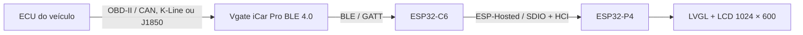
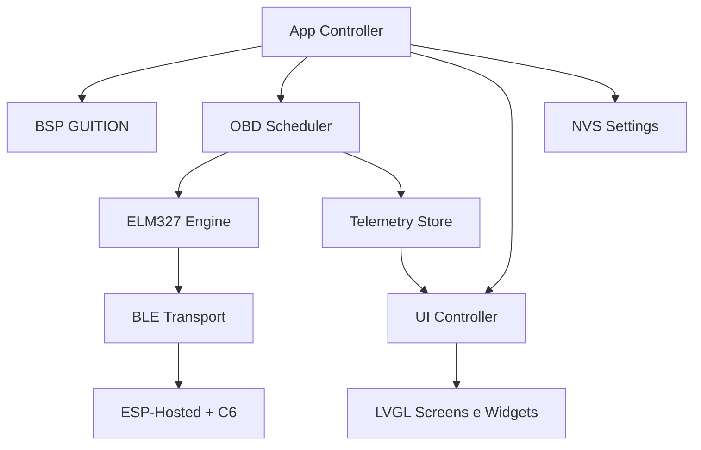
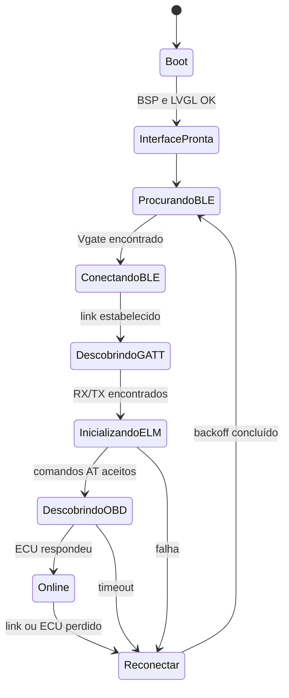
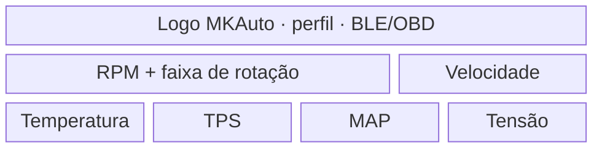
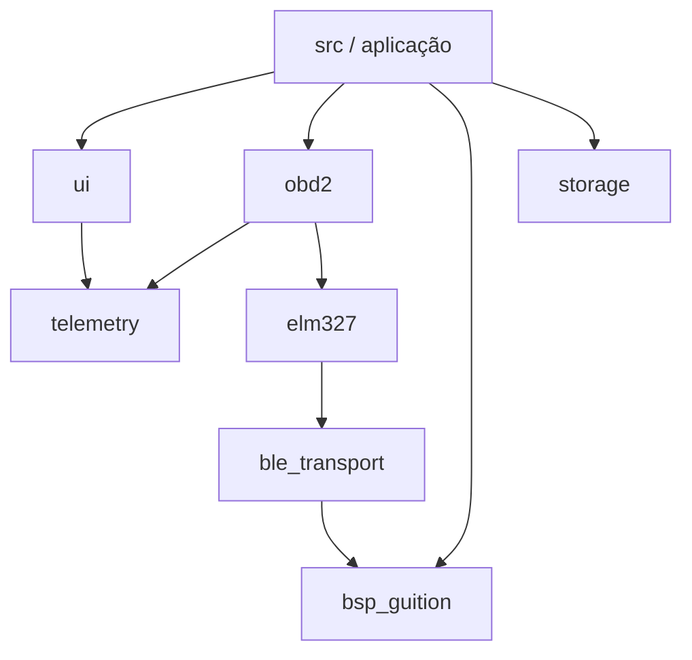

# MKAuto Dashboard — Requisitos e Arquitetura do Projeto

| Campo | Valor |
|---|---|
| Documento | Especificação de produto e arquitetura de firmware |
| Projeto | MKAuto Dashboard |
| Versão | 0.1 — baseline inicial |
| Data | 2026-09-08 |
| Estado | Em definição; apto para iniciar o bring-up |
| Plataforma | GUITION JC1060P470C_I_W_Y |
| Interface veicular | Vgate iCar Pro BLE 4.0 |
| Framework | ESP-IDF 5.5.x |

> Este documento registra as decisões atuais e separa requisitos confirmados de itens que ainda dependem de teste físico. O produto usa como referência apenas a hierarquia de informação de painéis automotivos como a FT450. A composição visual, identidade, componentes gráficos e implementação devem ser originais da MKAuto.

## 1. Visão do produto

O MKAuto Dashboard será um painel automotivo auxiliar programável, com tela capacitiva de 7 polegadas, destinado a exibir em tempo real informações obtidas da ECU por meio da porta OBD-II.

O sistema será composto por dois produtos comerciais:

1. Tela GUITION JC1060P470C_I_W_Y, baseada em ESP32-P4 com ESP32-C6 como coprocessador de rádio.
2. Scanner Vgate iCar Pro BLE 4.0, compatível com comandos do tipo ELM327.

A comunicação entre a tela e o scanner será sem fio por Bluetooth Low Energy. O firmware da tela será desenvolvido especificamente para a MKAuto.

### 1.1 Objetivo principal

Disponibilizar uma leitura rápida, clara e confiável dos principais parâmetros do veículo, com foco em:

- RPM;
- velocidade;
- temperatura do líquido de arrefecimento;
- tensão informada pelo módulo;
- carga calculada do motor;
- posição da borboleta;
- pressão absoluta do coletor;
- estado da conexão BLE e OBD-II.

### 1.2 Posicionamento do produto

O painel é um instrumento auxiliar e de leitura. Ele não substitui o painel original, não executa controle do motor e não é um equipamento de segurança funcional.

## 2. Decisões já confirmadas

| ID | Decisão |
|---|---|
| DEC-001 | O nome de trabalho do produto é **MKAuto Dashboard**. |
| DEC-002 | A identidade principal utilizará o símbolo vermelho “MK” sobre base escura. |
| DEC-003 | A tela alvo é a **GUITION JC1060P470C_I_W_Y**, 1024 × 600, touch capacitivo. |
| DEC-004 | O scanner alvo é o **Vgate iCar Pro BLE 4.0**, original. |
| DEC-005 | A comunicação principal será BLE/GATT; Bluetooth Classic não faz parte do projeto. |
| DEC-006 | O firmware será baseado em **ESP-IDF 5.5.x**, com a versão de patch fixada no início da implementação. |
| DEC-007 | A interface gráfica será implementada com **LVGL 9.x**. |
| DEC-008 | A primeira versão utilizará OBD-II genérico, com protocolos e PIDs proprietários adicionados posteriormente por perfil de veículo. |
| DEC-009 | O MVP será estritamente de leitura e não enviará comandos para apagar falhas, atuar módulos ou programar o veículo. |
| DEC-010 | O firmware da aplicação será escrito predominantemente em C, seguindo C11. |
| DEC-011 | (2026-11-04) O primeiro veículo é um **Corsa Wind 2002 1.0 8V a gasolina**, cuja ECU usa protocolo específico; a leitura via ELM é desenvolvida em paralelo pelo usuário. A interface não pode depender de PIDs genéricos: consome sinais por identificador do catálogo de telemetria, qualquer que seja a origem. |
| DEC-012 | (2026-11-04) A interface é desenvolvida antes de M1–M3, alimentada por uma fonte de telemetria simulada que publica no mesmo modelo usado pela futura fonte ELM. A fonte simulada é selecionada por configuração de build e nunca é ativada junto da fonte real. |
| DEC-013 | (2026-11-04) Destaques do dashboard: conta-giros e velocidade (o veículo não possui essas informações de forma adequada). Os demais campos são cards configuráveis pelo usuário, podendo exibir qualquer sinal disponível da ECU. |
| DEC-014 | (2026-11-04) A marcha é derivada da razão RPM/velocidade contra relações calibradas do veículo, independentemente da fonte de velocidade (ECU, GPS ou VSS). Sem velocidade confiável a marcha não é exibida; não se estima marcha só por RPM/MAP/TPS. |

## 3. Premissas e limites

### 3.1 Premissas

- O scanner adquirido deve ser exatamente a variante **BLE 4.0**, não a variante BT 3.0 nem Wi-Fi.
- O scanner deve ser original ou possuir o mesmo firmware e perfil GATT do produto original.
- O veículo deve ser compatível com OBD-II e disponibilizar pelo menos os PIDs exigidos para a tela principal.
- A tela será alimentada por uma fonte externa de 5 V dimensionada para seu consumo de pico.
- A disponibilidade de um PID depende do veículo; a compatibilidade do scanner não obriga a ECU a fornecer todos os parâmetros.
- A primeira validação deverá ser feita em um veículo-alvo definido e documentado.

### 3.2 Fora do escopo do MVP

- apagar DTCs;
- codificação ou programação de módulos;
- funções equivalentes a VCDS, Carista ou Carly;
- atuação sobre a ECU;
- leitura direta do barramento CAN sem o Vgate;
- telemetria em nuvem;
- aplicativo para celular;
- navegação GPS;
- substituição homologada do painel original;
- suporte universal a qualquer scanner ELM327.

## 4. Arquitetura física



### 4.1 Componentes principais

| Elemento | Responsabilidade |
|---|---|
| Porta OBD-II | Alimentar o scanner e disponibilizar o protocolo veicular. |
| Vgate iCar Pro BLE 4.0 | Traduzir os comandos ELM327 para o protocolo utilizado pelo veículo. |
| ESP32-C6 | Executar o controlador BLE e transportar os dados para o ESP32-P4. |
| ESP32-P4 | Executar aplicação, parser ELM327/OBD-II, modelo de telemetria e interface LVGL. |
| LCD MIPI-DSI | Exibir a interface em 1024 × 600. |
| Touch GT911 | Navegação e configuração local. |
| Fonte 12 V → 5 V | Alimentar a tela de forma independente do scanner. |

### 4.2 Plataforma GUITION

Especificações utilizadas como baseline:

| Recurso | Especificação |
|---|---|
| MCU principal | ESP32-P4, dual-core RISC-V |
| Coprocessador sem fio | ESP32-C6 |
| Flash | 16 MB |
| PSRAM | 32 MB |
| Tela | 7 polegadas, 1024 × 600, capacitiva |
| Interface de vídeo | MIPI-DSI, duas lanes |
| Controlador de LCD | JD9165/variante correspondente ao painel montado |
| Controlador touch | GT911 via I²C |
| Cor de renderização inicial | RGB565, 16 bits por pixel |
| Orientação | Paisagem |

### 4.3 Mapa provisório do BSP

O seguinte mapa é a baseline dos arquivos de referência da placa. Ele deve ser comparado ao esquema da revisão física recebida antes de ser congelado no código.

| Função | Recurso provisório |
|---|---|
| I²C SDA do touch | GPIO7 |
| I²C SCL do touch | GPIO8 |
| GT911 RESET | GPIO22 |
| GT911 INTERRUPT | GPIO21 |
| Endereço GT911 | `0x5D` |
| Backlight PWM | GPIO23 |
| LCD RESET | GPIO27 |
| ESP32-C6 RESET | GPIO54 |
| SDIO CMD | GPIO19 |
| SDIO CLK | GPIO18 |
| SDIO D0…D3 | GPIO14, GPIO15, GPIO16, GPIO17 |

Os parâmetros completos de inicialização do JD9165, pixel clock, lane bitrate e porches não devem ser duplicados em vários arquivos. Eles serão mantidos em uma única configuração do BSP e congelados após o teste visual do marco M0.

### 4.4 Alimentação

- O Vgate será alimentado diretamente pela porta OBD-II.
- A GUITION será alimentada por 5 V externos.
- Para protótipo em veículo, usar conversor automotivo comercial 12 V → 5 V com saída mínima recomendada de 3 A e margem para partida do motor.
- Não assumir que o Vgate pode alimentar a tela.
- Na futura versão de produto, a alimentação deverá ser validada contra inversão de polaridade, load dump, transientes de partida e queda de tensão.

## 5. Stack de software

| Camada | Tecnologia ou componente |
|---|---|
| Sistema e drivers | ESP-IDF 5.5.x |
| Build | CMake + `idf.py` |
| RTOS | FreeRTOS fornecido pelo ESP-IDF |
| GUI | LVGL 9.x |
| LCD | `esp_lcd` + driver JD9165 validado para a placa |
| Touch | `esp_lcd_touch_gt911` ou driver equivalente validado |
| Rádio remoto | `espressif/esp_hosted` 3.x |
| BLE host | NimBLE no ESP32-P4, usando o ESP32-C6 como controlador remoto por HCI |
| Persistência | NVS |
| Logs | `esp_log` |
| Testes | Unity do ESP-IDF e testes de parser executáveis no host quando aplicável |

### 5.1 Política de versões

- Usar ESP-IDF `>=5.5,<5.6`.
- Fixar a versão exata do ESP-IDF no README e na configuração do ambiente de CI.
- Iniciar com `esp_hosted` 3.x compatível com ESP-IDF 5.5; host P4 e firmware slave do C6 devem usar versões compatíveis.
- Fixar todas as dependências após o primeiro bring-up aprovado.
- Versionar `dependencies.lock`.
- Não alterar drivers, LVGL ou ESP-Hosted durante uma etapa de validação sem registrar a mudança.

### 5.2 Memória gráfica e renderização

- Configurar o pipeline gráfico inicialmente em RGB565.
- Um framebuffer completo de 1024 × 600 × 16 bits ocupa 1.228.800 bytes, aproximadamente 1,17 MiB.
- A meta é utilizar dois framebuffers completos, aproximadamente 2,34 MiB, alocados em PSRAM.
- Habilitar DMA2D quando suportado pelo driver validado.
- Medir FPS, tempo de flush e uso de memória antes de habilitar efeitos visuais adicionais.
- Fontes devem conter apenas os tamanhos e caracteres realmente usados.
- Imagens do logotipo e ícones devem ser convertidas no build; não decodificar arquivos grandes continuamente durante o dashboard.

### 5.3 Particionamento da flash

- O bring-up pode iniciar com partição de aplicação única para reduzir variáveis.
- Antes da primeira versão distribuível, reservar duas partições de aplicação caso a atualização OTA entre no escopo.
- Manter partições distintas para NVS, `otadata`, aplicação, coredump e eventual armazenamento de recursos.
- Definir os tamanhos finais somente após medir o binário com todos os assets e fontes do MVP.
- O layout aprovado deverá ser versionado em `partitions.csv`; alterações posteriores exigem plano de migração.

## 6. Arquitetura do firmware



### 6.1 Responsabilidades dos módulos

| Módulo | Responsabilidade | Não deve fazer |
|---|---|---|
| `bsp_guition` | Inicializar LCD, touch, backlight, PSRAM e transporte P4↔C6. | Conhecer PIDs ou telas da aplicação. |
| `ble_transport` | Escanear, selecionar, conectar, descobrir GATT, enviar bytes e receber notificações. | Interpretar respostas ELM327. |
| `elm327` | Serializar comandos, detectar prompt, controlar timeout e normalizar respostas. | Atualizar objetos LVGL ou calcular widgets. |
| `obd2` | Descobrir PIDs, agendar consultas e converter payloads em valores físicos. | Acessar diretamente o driver BLE. |
| `telemetry` | Manter último valor, timestamp, qualidade e unidade de cada sinal. | Iniciar consultas ou desenhar a interface. |
| `ui` | Criar telas, aplicar tema e apresentar snapshots de telemetria. | Chamar BLE/ELM diretamente. |
| `storage` | Salvar configurações e identidade do adaptador no NVS. | Armazenar dados em alta frequência. |
| `diagnostics` | Métricas internas, contadores e informações de suporte. | Alterar o comportamento normal da coleta. |
| `app_controller` | Coordenar boot, estados globais e recuperação de falhas. | Implementar detalhes de protocolo. |

### 6.2 Modelo de execução

| Contexto | Responsabilidade | Comunicação |
|---|---|---|
| Task/eventos BLE | Eventos do NimBLE, conexão e notificações GATT. | Stream buffer e event group. |
| `obd_task` | Máquina de estados ELM327, fila de comandos e scheduler de PIDs. | Recebe bytes BLE e publica amostras. |
| `ui_task` | `lv_timer_handler`, animações e atualização visual. | Lê snapshot de telemetria. |
| `app_controller` | Inicialização e supervisão de alto nível. | Eventos de estado. |

Regras obrigatórias de concorrência:

- Somente a task da interface pode chamar APIs do LVGL.
- Callbacks BLE não podem bloquear nem alterar widgets.
- Deve existir no máximo um comando ELM327 em andamento.
- Notificações BLE podem chegar fragmentadas e devem ser remontadas até o prompt `>`.
- O modelo de telemetria deve disponibilizar snapshots coerentes para a interface.
- O loop de consulta não pode fazer alocações dinâmicas contínuas em regime permanente.

## 7. Estados do sistema



### 7.1 Comportamento de recuperação

- Exibir a interface mesmo quando o scanner estiver ausente.
- Após perda de conexão, marcar os dados como desatualizados antes de tentar reconectar.
- Usar backoff limitado, inicialmente 1 s, 2 s, 5 s e depois 10 s entre tentativas.
- Não reiniciar toda a tela devido a uma falha BLE ou OBD-II.
- Reiniciar o subsistema de rádio apenas após falhas repetidas e registradas.
- Nunca manter na tela um valor antigo como se ainda fosse atual.

## 8. Comunicação BLE com o Vgate

### 8.1 Descoberta e seleção

O firmware deverá:

1. iniciar o ESP32-C6 pelo ESP-Hosted;
2. iniciar o NimBLE no P4 como central GATT;
3. procurar anúncios do Vgate;
4. classificar candidatos por endereço salvo, nome e serviços anunciados;
5. permitir seleção manual na primeira utilização quando houver mais de um candidato;
6. salvar a identidade aprovada no NVS;
7. reconectar automaticamente nas inicializações seguintes.

Nomes esperados podem incluir `IOS-VLINK`, `ANDROID-VLINK`, `V-LINK` ou variações observadas no hardware. O nome não deve ser a única forma de autenticar o dispositivo.

### 8.2 Perfil GATT

- Descobrir serviços e características depois de conectar.
- Identificar uma característica de escrita para comandos e uma característica com `notify` ou `indicate` para respostas.
- Habilitar notificações antes de enviar o primeiro comando.
- Registrar UUIDs e propriedades encontrados na página de diagnóstico.
- Congelar no código o perfil exato observado no Vgate adquirido após o marco M1.
- Encerrar todos os comandos com `\r`.

O suporte a perfis alternativos deve existir somente se for necessário para a revisão real do Vgate, evitando transformar o MVP em uma biblioteca universal de scanners.

## 9. Camada ELM327

### 9.1 Sequência inicial proposta

```text
ATZ       ; reset e identificação
ATE0      ; desabilitar eco
ATL0      ; desabilitar line feed
ATS0      ; remover espaços
ATH0      ; ocultar headers no modo OBD-II genérico
ATSP0     ; seleção automática do protocolo veicular
ATI       ; registrar identificação do adaptador
ATRV      ; registrar tensão medida pelo adaptador
0100      ; consultar grupo inicial de PIDs suportados
```

A sequência poderá ser ajustada depois do teste físico, mas deve continuar centralizada em um único módulo.

### 9.2 Regras do parser

- Tratar `\r`, `\n`, espaços e eco de comando.
- Considerar `>` como final da transação.
- Aceitar resposta dividida entre múltiplas notificações BLE.
- Detectar e classificar pelo menos:
  - `OK`;
  - `NO DATA`;
  - `UNABLE TO CONNECT`;
  - `SEARCHING...`;
  - `STOPPED`;
  - `CAN ERROR`;
  - `BUS INIT...ERROR`;
  - `?`;
  - timeout sem prompt.
- Validar comprimento do payload antes da conversão.
- Descartar respostas que não correspondam ao modo e PID solicitados.
- Manter contadores separados para timeout, resposta inválida, PID não suportado e desconexão.

## 10. Aquisição e modelo de telemetria

### 10.1 PIDs genéricos candidatos ao MVP

| Prioridade | Sinal | Modo/PID | Conversão | Taxa-alvo inicial | Observação |
|---|---|---|---|---:|---|
| Alta | RPM | `01 0C` | `((A × 256) + B) / 4` rpm | 8 Hz | Dado principal. |
| Alta | Velocidade | `01 0D` | `A` km/h | 5 Hz | Dado principal. |
| Alta | Posição da borboleta | `01 11` | `100 × A / 255` % | 4 Hz | Exibir se suportado. |
| Alta | MAP | `01 0B` | `A` kPa | 4 Hz | Pode auxiliar no cálculo de boost. |
| Média | Carga calculada | `01 04` | `100 × A / 255` % | 2 Hz | Não representa torque real. |
| Média | Fluxo MAF | `01 10` | `((A × 256) + B) / 100` g/s | 2 Hz | Opcional por veículo. |
| Média | Temperatura do motor | `01 05` | `A - 40` °C | 1 Hz | Possui limites de alerta configuráveis. |
| Média | Tensão do módulo | `01 42` | `((A × 256) + B) / 1000` V | 1 Hz | Não confundir com `ATRV`. |
| Baixa | Temperatura do ar | `01 0F` | `A - 40` °C | 0,5 Hz | Tela secundária. |
| Baixa | Nível de combustível | `01 2F` | `100 × A / 255` % | 0,2 Hz | Frequentemente indisponível. |
| Baixa | Tempo de funcionamento | `01 1F` | `(A × 256) + B` s | 0,2 Hz | Estatística de sessão. |

As taxas são objetivos do scheduler, não garantias do veículo. O sistema deverá medir o tempo real de resposta e reduzir as frequências de menor prioridade quando o throughput do ELM327 não for suficiente.

### 10.2 Dados que não podem ser assumidos como universais

Os seguintes itens somente poderão ser exibidos quando existir um PID confirmado para o veículo ou um cálculo tecnicamente validado:

- marcha engatada;
- pressão do óleo;
- temperatura do óleo;
- temperatura do câmbio;
- pressão de turbo direta;
- odômetro total;
- autonomia;
- pressão de combustível específica;
- dados de ABS, airbag, transmissão ou carroceria.

Quando indisponível, o campo deve desaparecer ou apresentar `N/D`; nunca deve receber um valor inventado.

### 10.3 Estrutura lógica de uma amostra

```c
typedef enum {
    MK_SIGNAL_UNAVAILABLE,
    MK_SIGNAL_VALID,
    MK_SIGNAL_STALE,
    MK_SIGNAL_ERROR
} mk_signal_quality_t;

typedef struct {
    float value;
    uint32_t timestamp_ms;
    mk_signal_quality_t quality;
} mk_signal_sample_t;
```

Internamente, todos os valores usarão unidades SI ou a unidade OBD nativa definida no catálogo. Conversões apenas para apresentação serão feitas na camada da interface.

### 10.4 Validade temporal

| Classe de sinal | Marcar como `STALE` | Marcar como indisponível após perda de conexão |
|---|---:|---:|
| RPM, velocidade, TPS e MAP | 500 ms sem atualização | 2 s |
| Carga e MAF | 1 s | 3 s |
| Temperaturas e tensão | 3 s | 5 s |
| Dados lentos | 10 s | 15 s |

Os limites serão refinados usando logs do veículo-alvo.

## 11. Interface gráfica e identidade MKAuto

### 11.1 Direção visual

A FT450 é referência apenas para os seguintes princípios:

- informação principal grande e legível;
- hierarquia visual clara;
- leitura rápida com visão periférica;
- faixa de RPM com indicação de atenção e limite;
- parâmetros secundários agrupados em blocos.

Não devem ser reproduzidos:

- logotipo ou nome FuelTech;
- proporções exatas dos elementos;
- tipografia proprietária;
- mesma grade ou disposição de campos;
- moldura, ícones ou elementos gráficos característicos;
- combinação idêntica de cores e barras.

### 11.2 Identidade visual

| Token | Valor inicial | Uso |
|---|---|---|
| `color_bg` | `#07090C` | Fundo principal. |
| `color_surface` | `#12161C` | Cards e superfícies. |
| `color_surface_alt` | `#1A2028` | Separação de regiões. |
| `color_brand` | `#FF1F24` | Marca MKAuto, seleção e faixa crítica. |
| `color_text` | `#F5F7FA` | Valores principais. |
| `color_text_muted` | `#8C96A3` | Rótulos e unidades. |
| `color_ok` | `#21C875` | Estado normal confirmado. |
| `color_warning` | `#FFB020` | Atenção. |
| `color_critical` | `#FF3B30` | Alarme crítico. |

Diretrizes:

- Fundo predominantemente preto/grafite, alinhado à marca.
- O vermelho da marca não deve ser usado como cor normal de todos os indicadores; ele deve preservar contraste e significado.
- Alertas devem combinar cor, texto e/ou ícone. A cor não pode ser o único sinal.
- Usar tipografia sem serifa, altamente legível. A baseline é Montserrat do LVGL, com tamanhos compilados somente quando usados.
- Valores numéricos devem utilizar alinhamento estável para não “pular” durante atualizações.
- Evitar gradientes pesados, reflexos e texturas que prejudiquem a leitura.

Revisão 2026-11-04, extraída do monograma fornecido (`assets/brand/mk_logo_source.png`) e aplicada em `lib/ui/src/mk_ui_internal.h`: `color_bg` `#050506`, `color_surface` `#0F0E11` (bloco da logo), `color_surface_alt` `#1C1B20`, `color_brand` `#F91315`, `color_text` `#F5F5F7`, `color_text_muted` `#7D7B84`. Linguagem visual: blocos arredondados e cortes diagonais paralelos inclinados como os do monograma; zona de atenção e alertas usam o vermelho da marca, sempre acompanhados de texto.

### 11.3 Tratamento do logotipo

- A arte “MK” fornecida é a referência oficial do símbolo.
- Preparar uma variante com fundo transparente antes da integração final.
- Manter área livre mínima de 12% da largura do símbolo ao redor da marca.
- Não distorcer, inclinar ou recolorir o símbolo em estados normais.
- Gerar versões raster adequadas à resolução real; não usar a imagem-fonte inteira em cada frame.
- Exibir a marca na tela de abertura e de forma discreta na barra superior.
- O nome textual “MKAuto” poderá acompanhar o símbolo em telas de configuração e diagnóstico.

### 11.4 Layout principal proposto



Distribuição inicial para 1024 × 600:

| Região | Conteúdo |
|---|---|
| Barra superior | Símbolo MK, nome do perfil e estado BLE/OBD. |
| Área principal esquerda | RPM em número grande e barra/faixa de rotação própria da MKAuto. |
| Área principal direita | Velocidade em número grande e unidade. |
| Faixa inferior | Quatro cards configurados para temperatura, TPS, MAP e tensão. |
| Overlay de estado | Mensagens de conexão, dados indisponíveis e alertas. |

### 11.5 Telas do MVP

| Tela | Conteúdo |
|---|---|
| `Splash` | Símbolo MK, versão do firmware e transição curta. |
| `Conexão` | Scanner encontrado, estado BLE, estado ELM e estado ECU. |
| `Dashboard` | RPM, velocidade e quatro parâmetros secundários. |
| `Métricas` | Lista ampliada dos PIDs suportados pelo veículo. |
| `Configurações` | Brilho, limite de RPM, unidade de velocidade, adaptador selecionado e perfil. |
| `Diagnóstico` | UUIDs GATT, `ATI`, protocolo, latência, PIDs suportados e contadores de erro. |

### 11.6 Interação e segurança de uso

- Área tocável mínima de 48 × 48 px.
- Nenhuma operação importante deve exigir toque contínuo enquanto o veículo está em movimento.
- Configurações devem ficar bloqueadas ou reduzidas quando a velocidade for superior a 5 km/h.
- A tela principal deve voltar automaticamente após período de inatividade nas configurações.
- A perda de conexão deve ser visível sem cobrir permanentemente RPM e velocidade.
- Animações de suavização podem durar entre 80 e 150 ms, sem esconder mudanças reais ou atrasar alertas.

## 12. Requisitos funcionais

| ID | Prioridade | Requisito verificável |
|---|---|---|
| RF-001 | Obrigatório | O firmware deve inicializar LCD, touch, backlight, PSRAM e coprocessador C6 sem intervenção do usuário. |
| RF-002 | Obrigatório | O sistema deve apresentar a tela de abertura com a marca MKAuto durante o boot. |
| RF-003 | Obrigatório | O sistema deve procurar automaticamente o Vgate iCar Pro BLE 4.0. |
| RF-004 | Obrigatório | Na primeira conexão, deve ser possível selecionar o adaptador quando mais de um candidato for encontrado. |
| RF-005 | Obrigatório | O adaptador aprovado deve ser salvo e priorizado nos boots seguintes. |
| RF-006 | Obrigatório | O sistema deve descobrir e configurar as características GATT de escrita e notificação. |
| RF-007 | Obrigatório | O sistema deve executar a inicialização ELM327 e informar claramente cada estágio da conexão. |
| RF-008 | Obrigatório | O sistema deve consultar `0100` e grupos adicionais necessários antes de habilitar cada PID. |
| RF-009 | Obrigatório | O scheduler deve priorizar RPM e velocidade e adaptar sinais secundários ao throughput disponível. |
| RF-010 | Obrigatório | Cada amostra deve possuir valor, timestamp e qualidade. |
| RF-011 | Obrigatório | Valores vencidos devem ser marcados como desatualizados e não podem permanecer como válidos. |
| RF-012 | Obrigatório | A tela principal deve exibir RPM, velocidade, estados BLE/OBD e até quatro sinais secundários suportados. |
| RF-013 | Obrigatório | Um PID não suportado deve ser mostrado como `N/D` ou removido da composição. |
| RF-014 | Obrigatório | O sistema deve reconectar automaticamente após perda do Vgate ou da ECU. |
| RF-015 | Obrigatório | O sistema deve continuar responsivo durante scan, timeout e reconexão. |
| RF-016 | Obrigatório | O MVP não pode transmitir comandos de escrita, reset de falhas ou programação ao veículo. |
| RF-017 | Desejável | O usuário deve poder ajustar brilho e limite visual de RPM. |
| RF-018 | Desejável | A página de diagnóstico deve exibir dados suficientes para identificar falhas de BLE, ELM e ECU. |
| RF-019 | Desejável | O firmware deve suportar perfis de veículo sem misturar PIDs proprietários ao catálogo genérico. |
| RF-020 | Futuro | Registrar sessões ou telemetria em cartão microSD. |
| RF-021 | Futuro | Atualização OTA assinada usando Wi-Fi do C6. |

## 13. Requisitos não funcionais

| ID | Categoria | Requisito/critério |
|---|---|---|
| RNF-001 | Build | Compilar com ESP-IDF 5.5.x usando somente comandos documentados no README. |
| RNF-002 | Desempenho | Manter no mínimo 30 FPS na tela principal durante coleta BLE ativa; alvo de 60 FPS se não comprometer estabilidade. |
| RNF-003 | Latência visual | Refletir uma amostra válida na tela em até 100 ms após sua publicação no modelo de telemetria. |
| RNF-004 | Boot | Mostrar conteúdo visual em até 2 s após a inicialização normal da alimentação. |
| RNF-005 | Conexão | Conectar ao adaptador já conhecido em até 10 s em condições normais, excluindo o tempo de inicialização da ECU. |
| RNF-006 | Fluidez | Scan e comunicação OBD não podem bloquear o `lv_timer_handler`. |
| RNF-007 | Memória | Manter pelo menos 20% de margem na heap interna e na PSRAM após estabilização do dashboard. |
| RNF-008 | Memória | Não apresentar crescimento contínuo de heap em teste de 2 h. |
| RNF-009 | Robustez | Recuperar-se de desligamento e religamento do Vgate sem reiniciar a aplicação inteira. |
| RNF-010 | Robustez | Acionar watchdog e registrar diagnóstico em caso de travamento real de task. |
| RNF-011 | Interface | Permanecer legível sob luz diurna compatível com a capacidade física do LCD e com brilho máximo. |
| RNF-012 | Manutenção | Nenhum módulo de protocolo pode depender de objetos LVGL. |
| RNF-013 | Manutenção | Drivers e números de GPIO devem ficar isolados no BSP. |
| RNF-014 | Qualidade | Compilar o código próprio com warnings elevados e sem novos warnings aceitos silenciosamente. |
| RNF-015 | Testabilidade | Conversões de PID e parser ELM327 devem possuir testes unitários independentes do hardware. |
| RNF-016 | Estabilidade | Um teste contínuo de 30 min em veículo não pode apresentar congelamento, reinício ou valor válido sem atualização. |

## 14. Organização do repositório

Estrutura proposta, preservando a separação `inc`, `src` e `lib` solicitada:

```text
mkauto-dashboard/
├── CMakeLists.txt
├── README.md
├── sdkconfig.defaults
├── sdkconfig.defaults.esp32p4
├── partitions.csv
├── dependencies.lock
├── inc/
│   ├── mk_app_config.h
│   ├── mk_app_controller.h
│   ├── mk_app_events.h
│   └── mk_build_info.h
├── src/
│   ├── CMakeLists.txt
│   ├── idf_component.yml
│   ├── app_main.c
│   ├── mk_app_controller.c
│   └── mk_app_events.c
├── lib/
│   ├── bsp_guition/
│   │   ├── CMakeLists.txt
│   │   ├── inc/mk_bsp.h
│   │   └── src/
│   │       ├── mk_bsp.c
│   │       ├── mk_bsp_display.c
│   │       ├── mk_bsp_touch.c
│   │       ├── mk_bsp_backlight.c
│   │       └── mk_bsp_hosted.c
│   ├── ble_transport/
│   │   ├── CMakeLists.txt
│   │   ├── inc/mk_ble_transport.h
│   │   └── src/mk_ble_transport.c
│   ├── elm327/
│   │   ├── CMakeLists.txt
│   │   ├── inc/
│   │   │   ├── mk_elm327.h
│   │   │   └── mk_elm327_parser.h
│   │   └── src/
│   │       ├── mk_elm327.c
│   │       └── mk_elm327_parser.c
│   ├── obd2/
│   │   ├── CMakeLists.txt
│   │   ├── inc/
│   │   │   ├── mk_obd2.h
│   │   │   ├── mk_obd2_pid.h
│   │   │   └── mk_vehicle_profile.h
│   │   └── src/
│   │       ├── mk_obd2.c
│   │       ├── mk_obd2_pid.c
│   │       ├── mk_obd2_scheduler.c
│   │       └── mk_vehicle_profile_generic.c
│   ├── telemetry/
│   │   ├── CMakeLists.txt
│   │   ├── inc/mk_telemetry.h
│   │   └── src/mk_telemetry.c
│   ├── ui/
│   │   ├── CMakeLists.txt
│   │   ├── inc/mk_ui.h
│   │   └── src/
│   │       ├── mk_ui.c
│   │       ├── mk_ui_theme.c
│   │       ├── mk_ui_bindings.c
│   │       ├── screens/
│   │       │   ├── mk_screen_splash.c
│   │       │   ├── mk_screen_connection.c
│   │       │   ├── mk_screen_dashboard.c
│   │       │   ├── mk_screen_metrics.c
│   │       │   ├── mk_screen_settings.c
│   │       │   └── mk_screen_diagnostics.c
│   │       └── widgets/
│   │           ├── mk_widget_rpm.c
│   │           ├── mk_widget_value_card.c
│   │           └── mk_widget_connection.c
│   ├── storage/
│   │   ├── CMakeLists.txt
│   │   ├── inc/mk_storage.h
│   │   └── src/mk_storage.c
│   └── diagnostics/
│       ├── CMakeLists.txt
│       ├── inc/mk_diagnostics.h
│       └── src/mk_diagnostics.c
├── assets/
│   ├── brand/
│   │   ├── mk_logo_source.png
│   │   └── mk_logo_transparent.png
│   ├── fonts/
│   └── icons/
├── docs/
│   ├── ARCHITECTURE.md
│   ├── IMPLEMENTATION_PLAN.md
│   ├── INSTRUCOES_AGENTE.md
│   ├── CLAUDE.md
│   ├── bringup.md
│   ├── obd_capture_format.md
│   └── references/
│       └── ft450_visual_reference.png
├── firmware/
│   └── c6_slave/
│       └── README.md
├── test/
│   ├── host/
│   │   ├── test_elm327_parser.c
│   │   └── test_obd2_pid.c
│   ├── device/
│   │   ├── test_ble_vgate.c
│   │   └── test_telemetry.c
│   └── vectors/
│       ├── elm_responses.txt
│       └── obd_frames.txt
└── tools/
    └── asset_conversion/
```

### 14.1 Uso das pastas principais

- `inc/`: interfaces da camada principal da aplicação. Não deve conter headers internos das bibliotecas.
- `src/`: ponto de entrada e coordenação do produto. Deve permanecer pequeno.
- `lib/`: componentes internos independentes no formato de componentes ESP-IDF.
- `assets/`: fontes gráficas editáveis e recursos convertidos para firmware.
- `docs/`: decisões, testes, capturas e especificações.
- `firmware/c6_slave/`: versão, origem, hash e instruções da imagem ESP-Hosted gravada no C6; binários só serão versionados se a política do repositório permitir.
- `test/`: testes no host, no dispositivo e vetores capturados.
- `tools/`: ferramentas auxiliares; não devem ser necessárias para executar o firmware já compilado.

No `CMakeLists.txt` raiz, `src` será registrado como componente da aplicação e `lib` como diretório adicional de componentes. Cada biblioteca declarará explicitamente suas dependências e seu diretório `inc`.

Baseline do `CMakeLists.txt` raiz:

```cmake
cmake_minimum_required(VERSION 3.16)

set(EXTRA_COMPONENT_DIRS
    "${CMAKE_CURRENT_LIST_DIR}/src"
    "${CMAKE_CURRENT_LIST_DIR}/lib"
)

include($ENV{IDF_PATH}/tools/cmake/project.cmake)
project(mkauto_dashboard)
```

O `src/CMakeLists.txt` deverá registrar somente os arquivos da aplicação e incluir `../inc`. Cada pasta imediata de `lib` será um componente ESP-IDF com seu próprio `CMakeLists.txt`, `inc` e `src`.

### 14.2 Dependências permitidas



Dependências no sentido inverso são proibidas. Em especial, `telemetry`, `elm327` e `obd2` não podem incluir headers do módulo `ui`.

## 15. Convenções de implementação

- Prefixar símbolos próprios com `mk_`.
- Usar `snake_case` para arquivos, funções e variáveis.
- Usar tipos de largura fixa quando o tamanho fizer parte do protocolo.
- Manter valores físicos como `float` somente após validação do payload bruto.
- Não utilizar números de GPIO fora do `bsp_guition`.
- Não acessar NVS diretamente fora de `storage`.
- Não enviar strings diretamente ao BLE fora de `elm327`/`ble_transport`.
- Headers públicos ficam em `inc`; headers estritamente privados permanecem junto ao `src` do módulo.
- Código, símbolos e logs técnicos em inglês; textos apresentados ao usuário inicialmente em português.
- Cada módulo deve possuir uma responsabilidade principal e API curta.
- Erros recuperáveis devem retornar `esp_err_t` ou tipo de resultado próprio; não reiniciar o sistema como primeira resposta.
- Evitar abstrações destinadas a hardwares ou scanners não previstos no produto.

## 16. Configurações persistentes

| Chave | Valor inicial | Persistência |
|---|---|---|
| Brilho | 70% | NVS |
| Unidade de velocidade | km/h | NVS |
| Limite de RPM | definido pelo perfil; fallback 6500 rpm | NVS/perfil |
| Início da faixa de atenção | definido pelo perfil; fallback 5500 rpm | NVS/perfil |
| Adaptador BLE | nenhum no primeiro boot | NVS |
| Perfil do veículo | `generic_obd2` | NVS |
| Última tela | `dashboard` | Opcional; avaliar após MVP |

Endereço BLE, nomes e UUIDs devem ser armazenados sem dados secretos. A remoção do adaptador salvo deve exigir confirmação na interface.

## 17. Diagnóstico e observabilidade

A página de diagnóstico e os logs devem incluir:

- versão do firmware MKAuto;
- versão do ESP-IDF;
- versão do ESP-Hosted no host e no C6;
- nome e endereço do adaptador conectado;
- RSSI BLE;
- UUID de serviço, TX e RX;
- resultado de `ATI`;
- protocolo selecionado pelo ELM327;
- tempo médio, mínimo e máximo de uma consulta;
- taxa efetiva de consultas por segundo;
- PIDs suportados;
- contadores de timeout, `NO DATA`, resposta inválida e reconexões;
- heap interna mínima e PSRAM mínima;
- motivo do último reset.

Dados de diagnóstico não devem competir com a interface: logs repetitivos devem ter limitação de frequência.

## 18. Plano de testes

### 18.1 Testes unitários

- Conversão de todos os PIDs genéricos implementados.
- Parser com resposta completa, fragmentada e concatenada.
- Eco habilitado e desabilitado.
- Espaços e line feeds presentes ou ausentes.
- Respostas `NO DATA`, `CAN ERROR`, `STOPPED`, `?` e timeout.
- Transições de qualidade `VALID → STALE → UNAVAILABLE`.
- Priorização do scheduler sob throughput reduzido.

### 18.2 Testes de integração

| Teste | Critério de aprovação |
|---|---|
| Display | Imagem estável em 1024 × 600 por 30 min, sem flicker ou corrupção. |
| Touch | Todos os pontos e gestos previstos respondem corretamente. |
| BLE | Vgate encontrado, conectado e reconectado após desligamento. |
| GATT | Características descobertas e notificações recebidas sem perda de enquadramento. |
| ELM327 | `ATZ`, `ATI`, `ATRV` e `0100` respondem de forma válida. |
| OBD-II | RPM e velocidade acompanham o veículo sem congelamento. |
| Falha ECU | Ignição desligada gera estado correto, sem travar a interface. |
| Falha BLE | Remoção do Vgate invalida valores e inicia reconexão. |
| Desempenho | Dashboard mantém no mínimo 30 FPS durante coleta. |
| Estabilidade | 2 h ligado sem crescimento progressivo de heap. |

### 18.3 Teste em veículo

- Validar primeiramente com o veículo parado e freio de estacionamento aplicado.
- Comparar RPM, velocidade e temperatura com ferramenta de diagnóstico conhecida.
- Registrar os comandos e tempos de resposta, sem registrar dados pessoais desnecessários.
- Realizar teste dinâmico somente após estabilidade do teste parado.
- Durante o teste dinâmico, o operador não deve configurar a tela enquanto dirige.

## 19. Marcos de desenvolvimento

| Marco | Entrega | Critério de conclusão |
|---|---|---|
| M0 — BSP | LCD, touch, backlight e PSRAM | Demo gráfica estável e touch correto. |
| M1 — Rádio | ESP-Hosted, C6 e BLE central | Vgate encontrado; UUIDs e notificações registrados. |
| M2 — ELM327 | Transporte textual e parser | Comandos AT executados repetidamente sem perda de framing. |
| M3 — OBD-II | Descoberta e PIDs prioritários | RPM, velocidade e temperatura publicados no modelo. |
| M4 — Interface | Tema MKAuto e telas do MVP | Dashboard aprovado visualmente e responsivo. |
| M5 — Robustez | Reconexão, stale, watchdog e métricas | Testes de integração e 2 h aprovados. |
| M6 — Veículo | Perfil do primeiro veículo | Lista de PIDs e limites do veículo documentada. |

Ordem revisada em 2026-11-04 (DEC-012): M0 → M4 com telemetria simulada → M1 → M2 → M3 → integração real da interface. O gate G-M4 só fecha com dados reais do veículo; até lá a interface é validada com a fonte simulada.

## 20. Riscos técnicos

| ID | Risco | Impacto | Mitigação |
|---|---|---|---|
| RSK-001 | Revisão do Vgate usa UUIDs diferentes. | Sem tráfego de dados. | Descobrir GATT no M1, registrar perfil real e fixar fornecedor/modelo. |
| RSK-002 | Firmware do C6 incompatível com `esp_hosted` do host. | BLE não inicializa. | Usar versões compatíveis e regravar o slave do C6 quando necessário. |
| RSK-003 | Tempos do painel variam por revisão da GUITION. | Flicker ou tela sem imagem. | Isolar BSP e validar contra esquema/demo da unidade física. |
| RSK-004 | Veículo não fornece um PID desejado. | Campo sem informação. | Descoberta de suporte e composição adaptativa; perfil proprietário futuro. |
| RSK-005 | ELM327 possui baixa taxa de consultas. | RPM e velocidade lentos. | Scheduler por prioridade e redução automática de sinais secundários. |
| RSK-006 | Queda de tensão durante partida. | Reset ou corrupção visual. | Fonte automotiva adequada e teste de crank. |
| RSK-007 | Scanner falsificado ou variante errada. | Perfil ou comportamento diferente. | Comprar variante BLE 4.0 original e manter rastreabilidade do lote. |
| RSK-008 | Interface muito semelhante à FT450. | Risco visual e de identidade. | Criar grade, widgets, tipografia e linguagem visual próprias da MKAuto. |

## 21. Critérios de aceite do MVP

O MVP será considerado concluído quando:

1. inicializar consistentemente na GUITION especificada;
2. conectar automaticamente ao Vgate BLE salvo;
3. estabelecer comunicação ELM327 e OBD-II sem aplicativo intermediário;
4. exibir RPM, velocidade e pelo menos três sinais secundários reais;
5. identificar corretamente sinais não suportados;
6. invalidar dados antigos após perda de comunicação;
7. reconectar sem reboot completo;
8. manter pelo menos 30 FPS e touch responsivo;
9. concluir teste contínuo de 2 h sem travamento ou vazamento progressivo de memória;
10. manter o protocolo estritamente em modo leitura;
11. apresentar identidade visual própria da MKAuto;
12. possuir testes unitários para parser e conversões de PID.

## 22. Questões ainda abertas

As respostas abaixo refinam o produto, mas não impedem o início do M0 e M1:

1. ~~Qual será o primeiro veículo de validação?~~ Respondido em DEC-011 (câmbio ainda não informado).
2. ~~Quais quatro parâmetros devem ocupar os cards inferiores?~~ Respondido em DEC-013: cards configuráveis com qualquer sinal disponível.
3. O produto será apenas um protótipo pessoal ou deverá evoluir para venda?
4. O painel permanecerá ligado com a ignição desligada?
5. Será necessário registrar dados no microSD?
6. A interface terá apenas português ou deverá prever outros idiomas?
7. O limite de RPM será configurado manualmente ou definido por perfil de veículo?
8. Haverá gabinete e fixação próprios para uso permanente no veículo?

## 23. Referências

### 23.1 Referências visuais fornecidas

- `reference/ChatGPT Image 8 de set. de 2026, 09_34_11.png` — símbolo MK/MKAuto; caminho relativo à raiz do projeto.
- `reference/image.png` — referência visual externa da FT450, sem autorização para cópia de elementos proprietários; caminho relativo à raiz do projeto.

### 23.2 Referências técnicas

- [GUITION — JC1060P470C_I_W_Y](https://www.guition.com/esp32p4-display-module/7-inch-esp32p4-display-module)
- [Arquivos técnicos e demo da JC1060P470C_I_W](https://github.com/cheops/JC1060P470C_I_W)
- [ESP-IDF 5.5 — LCD MIPI-DSI no ESP32-P4](https://docs.espressif.com/projects/esp-idf/en/v5.5/esp32p4/api-reference/peripherals/lcd/dsi_lcd.html)
- [ESP-Hosted-MCU](https://github.com/espressif/esp-hosted-mcu)
- [ESP-Hosted no Component Registry](https://components.espressif.com/components/espressif/esp_hosted)
- [Vgate iCar Pro BLE 4.0](https://www.vgatemall.com/products-detail/i-9/)
- [Projeto de painel que validou o Vgate iCar Pro BLE 4.0](https://github.com/cheeseprince/obd-gauge-cluster/blob/main/docs/ADAPTERS.md)

---

**Próxima revisão prevista:** após definir o veículo-alvo e concluir M0/M1, atualizar o mapa definitivo do BSP, UUIDs GATT, versões travadas das dependências e catálogo real de PIDs.
