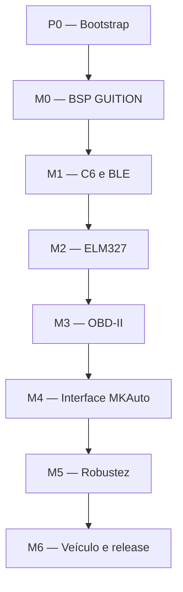

# MKAuto Dashboard — Plano de Implementação

| Campo | Valor |
|---|---|
| Documento | Plano de implementação do firmware e validação do produto |
| Projeto | MKAuto Dashboard |
| Versão | 0.1 — plano inicial |
| Data | 2026-09-08 |
| Estado | P0 em fechamento; M0 e M4 com telemetria simulada priorizados (2026-11-04) |
| Arquitetura de referência | `ARCHITECTURE.md` |
| Plataforma | GUITION JC1060P470C_I_W_Y |
| Interface veicular | Vgate iCar Pro BLE 4.0 |
| Framework | ESP-IDF 5.5.x |

> `ARCHITECTURE.md` define o que o sistema deve fazer e suas restrições. Este documento define a ordem de execução, as entregas e como comprovar que cada etapa está concluída. Em caso de conflito, `ARCHITECTURE.md` prevalece e o plano deve ser corrigido.

## 1. Objetivo deste plano

Conduzir a implementação do MKAuto Dashboard desde um repositório vazio até um MVP validado no primeiro veículo-alvo, reduzindo primeiro os riscos de hardware e comunicação:

1. provar o funcionamento da placa GUITION;
2. provar o enlace ESP32-P4 ↔ ESP32-C6;
3. provar a comunicação BLE/GATT com a unidade física do Vgate;
4. estabilizar a camada ELM327;
5. adquirir e validar dados OBD-II reais;
6. construir a interface MKAuto sobre uma fonte de dados já confiável;
7. validar recuperação de falhas, desempenho e uso no veículo.

O plano termina no MVP de leitura definido na arquitetura. Registro em microSD, OTA, Wi-Fi, comandos de diagnóstico destrutivos e PIDs proprietários adicionais permanecem fora desta entrega.

## 2. Regras de execução

- Validar primeiro o item de maior incerteza física de cada marco.
- Alterar uma variável de hardware ou configuração por vez durante o bring-up.
- Não marcar uma tarefa como concluída apenas porque compilou; cada tarefa deve possuir uma evidência verificável.
- Não implementar compatibilidade genérica com placas ou scanners não previstos.
- Não iniciar a interface final antes de RPM, velocidade e temperatura chegarem ao modelo de telemetria.
- Mockups e telemetria simulada são permitidos para testes, mas devem ficar claramente separados do caminho de produção.
- Somente a task da interface pode acessar LVGL.
- Somente uma transação ELM327 pode estar em andamento.
- O caminho de produção deve aceitar somente comandos de leitura autorizados.
- Todo valor mostrado deve possuir valor, timestamp e qualidade; dado vencido não pode permanecer como válido.
- O visual deve ser original da MKAuto. A FT450 continua sendo apenas referência de hierarquia de informação.
- As versões aprovadas do ESP-IDF, ESP-Hosted, LVGL e drivers devem ser fixadas depois do respectivo bring-up.
- Cada marco só começa formalmente depois da aprovação do gate anterior.

## 3. Convenções do plano

### 3.1 Status

| Símbolo | Significado |
|---|---|
| `[ ]` | Não iniciado |
| `[~]` | Em andamento |
| `[x]` | Concluído com evidência |
| `[!]` | Bloqueado |
| `[N/A]` | Não aplicável, com justificativa registrada |

### 3.2 Prioridade

| Prioridade | Uso |
|---|---|
| P0 | Bloqueia o marco ou protege a integridade do produto |
| P1 | Necessária para o MVP |
| P2 | Melhoria que pode ser adiada sem invalidar o MVP |

### 3.3 Evidência mínima

Uma tarefa concluída deve apontar para pelo menos uma destas evidências:

- build limpo e reproduzível;
- teste automatizado aprovado;
- log serial identificado com versão do firmware;
- captura de resposta BLE, ELM327 ou OBD-II;
- medição de memória, FPS ou latência;
- foto ou vídeo do hardware em funcionamento;
- registro no `docs/bringup.md`;
- relatório de teste no veículo.

## 4. Caminho crítico



O parser ELM327, as conversões de PID e os primeiros componentes gráficos podem ser desenvolvidos em paralelo usando testes no host. Sua integração ao firmware continua condicionada aos marcos anteriores.

**Replanejamento 2026-11-04 (DEC-012 da arquitetura):** M4 passa a ser executado logo após M0, alimentado por telemetria simulada. A leitura do Corsa via ELM é desenvolvida em paralelo pelo usuário e entra depois em M1–M3. G-M4 permanece aberto até o dashboard exibir dados reais.

## 5. Painel de progresso

| Marco | Estado inicial | Resultado esperado | Gate |
|---|---|---|---|
| P0 — Bootstrap | `[~]` | Repositório compila de forma reproduzível | G-P0 |
| M0 — BSP | `[~]` | LCD, touch, backlight e PSRAM estáveis | G-M0 |
| M1 — Rádio | `[ ]` | Vgate descoberto e GATT validado | G-M1 |
| M2 — ELM327 | `[ ]` | Transações textuais e parser estáveis | G-M2 |
| M3 — OBD-II | `[ ]` | Telemetria real publicada | G-M3 |
| M4 — Interface | `[ ]` | Telas MVP integradas e responsivas | G-M4 |
| M5 — Robustez | `[ ]` | Recuperação, persistência e estabilidade aprovadas | G-M5 |
| M6 — Veículo | `[ ]` | MVP validado e release reproduzível | G-M6 |

## 6. Pré-requisitos

### 6.1 Hardware

- [ ] Placa GUITION JC1060P470C_I_W_Y identificada por revisão e fotografada.
- [ ] Cabo USB de dados e método de gravação/debug do ESP32-P4 validados.
- [ ] Método de gravação ou atualização do firmware do ESP32-C6 documentado.
- [ ] Vgate iCar Pro identificado como variante BLE 4.0.
- [ ] Fonte 5 V com capacidade mínima de 3 A para a tela.
- [ ] Fonte 12 V protegida ou veículo para alimentar o Vgate.
- [ ] Chicote ou breakout OBD-II seguro para ensaio de bancada, se utilizado.
- [ ] Primeiro veículo-alvo disponível para M3 e M6.
- [ ] Ferramenta de diagnóstico conhecida para comparação no M6.

### 6.2 Software

- [ ] Git instalado e identidade de commits configurada.
- [ ] ESP-IDF 5.5.x instalado por método oficial.
- [ ] Python e toolchain usados pelo ESP-IDF validados por `idf.py --version` e por um build de referência.
- [ ] Porta serial e permissões de gravação validadas.
- [ ] Editor configurado para C11 e arquivos UTF-8.
- [ ] Ferramentas de teste no host definidas.

### 6.3 Baseline de versões a congelar

Preencher a tabela na primeira aprovação de cada dependência:

| Item | Versão aprovada | Origem/commit | Marco de congelamento |
|---|---|---|---|
| ESP-IDF | 5.5.5 (build aprovado; boot pendente) | v5.5.5 / b774170ff46c393eeb5e495ea37936038d3f4f4f | P0 |
| LVGL | `<definir 9.x>` | Component Manager | M0 |
| Driver JD9165 | `<definir>` | `<origem>` | M0 |
| Driver GT911 | `<definir>` | `<origem>` | M0 |
| ESP-Hosted host | `<definir 3.x>` | Component Manager | M1 |
| ESP-Hosted slave C6 | `<definir>` | `<tag/commit/hash>` | M1 |
| NimBLE | fornecido pelo IDF | ESP-IDF fixado | M1 |

## 7. P0 — Bootstrap do projeto

**Objetivo:** obter uma base mínima, reproduzível e organizada antes do bring-up físico.

**Dependências:** ambiente ESP-IDF instalado.

**Saída:** projeto vazio compila para ESP32-P4 a partir de um clone limpo.

### 7.1 Tarefas

| ID | Pri. | Estado | Tarefa | Evidência de conclusão |
|---|---:|:---:|---|---|
| P0-001 | P0 | `[x]` | Criar a estrutura raiz `inc`, `src`, `lib`, `assets`, `docs`, `firmware`, `test` e `tools` definida na arquitetura. | Árvore revisada e sem módulos adicionais especulativos. |
| P0-002 | P0 | `[x]` | Manter `ARCHITECTURE.md` e `IMPLEMENTATION_PLAN.md` em `docs/` e corrigir referências antigas ao nome anterior da especificação. | Documentos presentes em `docs/`; árvore da arquitetura corrigida e busca sem referências ao nome obsoleto. |
| P0-003 | P0 | `[x]` | Fixar o patch do ESP-IDF 5.5.x e registrar tag/commit no README. | `idf.py --version` registrado. |
| P0-004 | P0 | `[x]` | Criar `CMakeLists.txt` raiz e `src/CMakeLists.txt` com `src` como aplicação e `lib` como diretório de componentes. | Configuração CMake concluída sem warnings próprios. |
| P0-005 | P0 | `[x]` | Criar `app_main.c` mínimo e headers de aplicação em `inc/`. | Firmware inicia e imprime versão de build. |
| P0-006 | P1 | `[x]` | Criar `sdkconfig.defaults` e `sdkconfig.defaults.esp32p4`, contendo apenas opções já justificadas. | Um `sdkconfig` novo pode ser regenerado pelos defaults. |
| P0-007 | P1 | `[x]` | Criar `partitions.csv` inicial de aplicação única para bring-up. | Tabela aceita pelo build e tamanho livre documentado. |
| P0-008 | P1 | `[x]` | Declarar dependências iniciais em `src/idf_component.yml`. | Dependências resolvidas e `dependencies.lock` versionado. |
| P0-009 | P1 | `[~]` | Implementar informação de build: versão, commit, estado dirty e versão do IDF. | Dados visíveis no boot e na futura página de diagnóstico. |
| P0-010 | P1 | `[x]` | Definir níveis de warning, formatação e análise estática disponíveis no ambiente. | Build do código próprio sem warnings novos. |
| P0-011 | P1 | `[~]` | Criar esqueleto de testes no host e no dispositivo. | Suíte compartilhada criada; host parcialmente aprovado, execução física pendente. |
| P0-012 | P1 | `[~]` | Documentar instalação, build, flash, monitor e limpeza no `README.md`. | Comandos locais aprovados; reprodução em outro ambiente pendente. |

### 7.2 Comandos mínimos documentados

```bash
idf.py set-target esp32p4
idf.py reconfigure
idf.py build
idf.py flash monitor
idf.py size-components
```

O plano não deve depender de apagar manualmente `sdkconfig` a cada build normal. A regeneração a partir dos defaults será usada apenas para provar reprodutibilidade.

### 7.3 Gate G-P0

- [ ] Clone limpo configura e compila sem edição manual.
- [ ] O target efetivo é `esp32p4`.
- [ ] Versões e dependências estão registradas.
- [ ] O firmware mínimo inicia e informa seu build.
- [ ] Não existem credenciais, binários temporários ou diretórios de build versionados.

## 8. M0 — Bring-up do BSP GUITION

**Objetivo:** validar todos os recursos locais necessários à aplicação sem envolver BLE ou OBD-II.

**Dependências:** G-P0 aprovado e placa física disponível.

**Saída:** BSP isolado, display e touch estáveis, com medições iniciais de desempenho e memória.

### 8.1 Ordem de bring-up

1. identificação da revisão física;
2. alimentação e boot do ESP32-P4;
3. flash e PSRAM;
4. GPIOs de reset e backlight;
5. MIPI-DSI e JD9165;
6. LVGL;
7. GT911;
8. teste conjunto e estabilidade.

### 8.2 Tarefas

| ID | Pri. | Estado | Tarefa | Evidência de conclusão |
|---|---:|:---:|---|---|
| M0-001 | P0 | `[ ]` | Registrar modelo, revisão, componentes montados e diferenças em relação aos arquivos de referência da GUITION. | Registro em `docs/bringup.md`. |
| M0-002 | P0 | `[ ]` | Confirmar GPIOs do touch, backlight, resets e SDIO antes de congelá-los. | Tabela de pinos validada na unidade física. |
| M0-003 | P0 | `[x]` | Inicializar flash e PSRAM; executar teste básico de alocação e integridade. | Capacidade detectada e teste sem erro. |
| M0-004 | P0 | `[~]` | Implementar controle de reset do LCD e PWM do backlight em `bsp_guition`. | Brilho varia de desligado a máximo sem instabilidade. |
| M0-005 | P0 | `[x]` | Portar a sequência validada do JD9165 e configurar MIPI-DSI 1024 × 600 RGB565. | Padrões de cor e geometria exibidos corretamente. |
| M0-006 | P1 | `[x]` | Integrar LVGL 9.x ao `esp_lcd` sem dependência da aplicação dentro do BSP. | Tela de teste LVGL atualiza continuamente. |
| M0-007 | P1 | `[ ]` | Implementar dois framebuffers em PSRAM se a medição confirmar estabilidade; manter fallback documentado. | Memória e modo de buffer registrados. |
| M0-008 | P0 | `[x]` | Inicializar GT911 por I²C e validar endereço, reset, interrupção e orientação. | Coordenadas corretas nos quatro cantos e centro. |
| M0-009 | P1 | `[x]` | Ajustar transformação de touch à orientação paisagem. | Alvos visuais coincidem com o toque. |
| M0-010 | P1 | `[x]` | Criar tela técnica de teste com FPS, heap interna, PSRAM livre e touch. | Métricas legíveis sem logs excessivos. |
| M0-011 | P0 | `[ ]` | Executar teste contínuo do conjunto gráfico por 30 minutos. | Sem flicker, corrupção, reset ou perda do touch. |
| M0-012 | P1 | `[ ]` | Medir tempo até o primeiro conteúdo visível e estabelecer baseline. | Valor registrado para comparação com RNF-004. |

### 8.3 Arquivos principais

- `lib/bsp_guition/inc/mk_bsp.h`
- `lib/bsp_guition/src/mk_bsp.c`
- `lib/bsp_guition/src/mk_bsp_display.c`
- `lib/bsp_guition/src/mk_bsp_touch.c`
- `lib/bsp_guition/src/mk_bsp_backlight.c`
- `sdkconfig.defaults.esp32p4`
- `docs/bringup.md`

### 8.4 Gate G-M0

- [ ] Imagem 1024 × 600 estável por 30 minutos.
- [ ] Cores, orientação e área útil estão corretas.
- [ ] Touch responde corretamente em toda a tela.
- [ ] Backlight pode ser controlado de forma previsível.
- [ ] PSRAM detectada e utilizada conforme decisão documentada.
- [ ] FPS, heap e tempo de boot possuem baseline registrada.
- [ ] Todos os GPIOs permanecem encapsulados em `bsp_guition`.

## 9. M1 — ESP32-C6, ESP-Hosted e BLE

**Objetivo:** comprovar a cadeia P4 ↔ C6 ↔ BLE ↔ Vgate antes da implementação do protocolo ELM327.

**Dependências:** G-M0 aprovado, C6 acessível e Vgate alimentado.

**Saída:** central BLE conecta à unidade real do Vgate, descobre seu GATT e troca bytes brutos.

### 9.1 Tarefas

| ID | Pri. | Estado | Tarefa | Evidência de conclusão |
|---|---:|:---:|---|---|
| M1-001 | P0 | `[ ]` | Identificar a imagem atualmente gravada no C6 e o procedimento de recuperação/regravação. | Procedimento e versão registrados em `firmware/c6_slave/README.md`. |
| M1-002 | P0 | `[ ]` | Selecionar versões compatíveis do ESP-Hosted host e slave para ESP-IDF 5.5.x. | Host e slave registrados por tag/commit/hash. |
| M1-003 | P0 | `[ ]` | Inicializar reset e enlace SDIO entre P4 e C6. | Handshake repetível após dez power cycles. |
| M1-004 | P0 | `[ ]` | Inicializar HCI remoto e NimBLE no P4 no papel de central GATT. | Stack BLE inicia sem falha e sem bloquear a UI técnica. |
| M1-005 | P0 | `[ ]` | Implementar scan com filtros por endereço salvo, nome, propriedades e serviços disponíveis. | Lista de candidatos observável em log técnico. |
| M1-006 | P1 | `[ ]` | Implementar seleção temporária por console para o bring-up; a seleção por touch será integrada em M4. | Um Vgate específico pode ser escolhido sem recompilar. |
| M1-007 | P0 | `[ ]` | Conectar ao Vgate e executar descoberta completa de serviços, características e descritores. | UUIDs, propriedades e MTU registrados. |
| M1-008 | P0 | `[ ]` | Identificar característica de escrita e característica de notify/indicate. | Notificações habilitadas e confirmadas. |
| M1-009 | P0 | `[ ]` | Implementar envio e recepção de bytes brutos sem interpretar ELM327. | Um comando técnico controlado gera bytes de resposta. |
| M1-010 | P1 | `[ ]` | Medir RSSI, latência inicial, tamanho de notificações e fragmentação observada. | Medições adicionadas a `docs/bringup.md`. |
| M1-011 | P1 | `[ ]` | Implementar desconexão limpa e reconexão BLE básica. | Vgate pode ser desligado e religado sem reboot do P4. |
| M1-012 | P0 | `[ ]` | Congelar o perfil GATT da unidade adquirida sem criar suporte especulativo a outros scanners. | UUIDs reais documentados e cobertos por configuração. |

### 9.2 Arquivos principais

- `lib/bsp_guition/src/mk_bsp_hosted.c`
- `lib/ble_transport/inc/mk_ble_transport.h`
- `lib/ble_transport/src/mk_ble_transport.c`
- `firmware/c6_slave/README.md`
- `src/idf_component.yml`
- `dependencies.lock`

### 9.3 Gate G-M1

- [ ] O P4 inicia o C6 de forma repetível.
- [ ] O Vgate real aparece no scan.
- [ ] A conexão GATT é estabelecida.
- [ ] Características TX/RX e suas propriedades estão registradas.
- [ ] Notificações chegam ao P4 e bytes podem ser enviados.
- [ ] Desligar o Vgate não congela nem reinicia a interface.
- [ ] A compatibilidade foi comprovada com a unidade física; até este gate ela permanece uma hipótese de projeto.

## 10. M2 — Transporte e parser ELM327

**Objetivo:** transformar o fluxo BLE em transações textuais ELM327 confiáveis e testáveis.

**Dependências:** G-M1 aprovado e capturas reais disponíveis.

**Saída:** API assíncrona executa comandos, remonta respostas fragmentadas, detecta o prompt e classifica erros.

### 10.1 Tarefas

| ID | Pri. | Estado | Tarefa | Evidência de conclusão |
|---|---:|:---:|---|---|
| M2-001 | P0 | `[ ]` | Definir API entre `elm327` e `ble_transport`, sem tipos LVGL ou OBD-II. | Headers públicos curtos e revisão de dependências aprovada. |
| M2-002 | P0 | `[ ]` | Implementar buffer de recepção limitado, capaz de aceitar notificações fragmentadas e concatenadas. | Testes cobrem fragmentação em todos os limites relevantes. |
| M2-003 | P0 | `[ ]` | Implementar delimitador de transação pelo prompt `>` e terminação de comando por `\r`. | Resposta completa produz exatamente uma transação. |
| M2-004 | P0 | `[ ]` | Garantir no máximo um comando em andamento, com fila limitada e timeout explícito. | Teste rejeita ou agenda corretamente comandos concorrentes. |
| M2-005 | P0 | `[ ]` | Normalizar eco, CR/LF e espaços sem destruir o payload hexadecimal. | Vetores com `ATE0/ATE1`, `ATL0/ATL1` aprovados. |
| M2-006 | P0 | `[ ]` | Classificar `OK`, `NO DATA`, `UNABLE TO CONNECT`, `SEARCHING...`, `STOPPED`, `CAN ERROR`, `BUS INIT...ERROR`, `?` e timeout. | Teste unitário para cada classe. |
| M2-007 | P1 | `[ ]` | Implementar sequência centralizada `ATZ`, `ATE0`, `ATL0`, `ATS0`, `ATH0`, `ATSP0`, `ATI`, `ATRV`. | Dez inicializações seguidas concluídas ou erro corretamente classificado. |
| M2-008 | P1 | `[ ]` | Definir política limitada de retry por classe de erro. | Nenhum retry infinito; comportamento documentado. |
| M2-009 | P1 | `[ ]` | Adicionar contadores de timeout, erro de framing, resposta inválida e desconexão. | Contadores acessíveis a `diagnostics`. |
| M2-010 | P0 | `[ ]` | Armazenar respostas reais anonimizadas em `test/vectors/elm_responses.txt`. | Testes no host usam os vetores capturados. |
| M2-011 | P0 | `[ ]` | Executar stress de comandos `ATI`/`ATRV` repetidos. | Sem perda de framing, vazamento ou deadlock. |

### 10.2 Limites obrigatórios

- O callback BLE apenas entrega bytes; ele não espera a resposta inteira.
- O parser não chama BLE, NVS, LVGL nem o scheduler OBD-II.
- Buffers possuem tamanho máximo e erro explícito de overflow.
- Strings recebidas não são assumidas como terminadas em zero.
- Timeout usa relógio monotônico.
- Logs brutos podem ser habilitados para diagnóstico, mas ficam limitados em frequência na build normal.

### 10.3 Gate G-M2

- [ ] Sequência de inicialização aceita pela unidade real.
- [ ] Respostas completas, fragmentadas e concatenadas são interpretadas.
- [ ] Todos os erros mínimos da arquitetura são classificados.
- [ ] Não ocorre mais de uma transação simultânea.
- [ ] Testes do parser executam sem hardware.
- [ ] Stress repetido não apresenta crescimento contínuo de heap.

## 11. M3 — OBD-II e modelo de telemetria

**Objetivo:** descobrir PIDs suportados, consultar sinais por prioridade e publicar amostras coerentes.

**Dependências:** G-M2 aprovado e acesso ao primeiro veículo ou ECU/simulador compatível.

**Saída:** RPM, velocidade e temperatura chegam ao `telemetry` com valor, timestamp e qualidade.

### 11.1 Tarefas

| ID | Pri. | Estado | Tarefa | Evidência de conclusão |
|---|---:|:---:|---|---|
| M3-001 | P0 | `[ ]` | Definir catálogo estático de sinais e PIDs genéricos do MVP. | Cada item possui modo, PID, comprimento, unidade e conversão. |
| M3-002 | P0 | `[ ]` | Implementar consulta de `0100` e grupos adicionais somente quando indicados. | Máscara de suporte corresponde à ferramenta de referência. |
| M3-003 | P0 | `[ ]` | Validar modo, PID e comprimento antes de converter bytes. | Payload truncado ou de outro PID é rejeitado. |
| M3-004 | P0 | `[ ]` | Implementar e testar conversões de RPM, velocidade, TPS, MAP, carga, MAF, temperaturas, tensão, combustível e runtime. | Casos nominais e limites cobertos no host. |
| M3-005 | P0 | `[ ]` | Implementar `telemetry` com snapshot coerente e qualidades `UNAVAILABLE`, `VALID`, `STALE` e `ERROR`. | Testes de transição temporal aprovados. |
| M3-006 | P0 | `[ ]` | Implementar scheduler de um comando por vez, priorizando RPM e velocidade. | Frequências reais medidas e registradas. |
| M3-007 | P1 | `[ ]` | Reduzir automaticamente PIDs secundários quando a latência do adaptador aumentar. | Teste com throughput artificialmente limitado. |
| M3-008 | P0 | `[ ]` | Aplicar os limites iniciais de validade temporal definidos em `ARCHITECTURE.md`. | Valor passa a `STALE` e indisponível no tempo previsto. |
| M3-009 | P1 | `[ ]` | Implementar perfil `generic_obd2` sem PIDs proprietários. | Veículo sem PID opcional continua operando. |
| M3-010 | P0 | `[ ]` | Bloquear no caminho de produção modos OBD que não sejam explicitamente permitidos no MVP. | Tentativas de comando não autorizado falham antes do BLE. |
| M3-011 | P0 | `[ ]` | Publicar RPM, velocidade e temperatura a partir de respostas reais. | Log e snapshot mostram dados coerentes. |
| M3-012 | P1 | `[ ]` | Medir latência média, mínima, máxima e consultas por segundo. | Métricas disponíveis para diagnóstico. |
| M3-013 | P1 | `[ ]` | Criar publicador de telemetria simulada restrito a testes/desenvolvimento da UI. | Não é incluído ou ativável na build de produção. |

### 11.2 Gate G-M3

- [ ] PIDs suportados são descobertos antes de entrar no scheduler.
- [ ] RPM, velocidade e temperatura são publicados pelo modelo.
- [ ] Ao menos três sinais secundários estão disponíveis ou documentados como não suportados.
- [ ] Todas as conversões implementadas possuem testes unitários.
- [ ] Dado vencido muda de qualidade corretamente.
- [ ] O scheduler preserva a prioridade dos sinais principais.
- [ ] A build MVP não permite comandos OBD de escrita ou atuação.

## 12. M4 — Interface gráfica MKAuto

**Objetivo:** implementar as telas do MVP usando somente snapshots do modelo de telemetria.

**Dependências:** G-M0 aprovado. Desenvolvimento com `telemetry_sim` (DEC-012); a integração com dados reais depende de G-M3 e é requisito de G-M4.

**Saída:** interface original MKAuto, legível, responsiva e desacoplada da comunicação.

### 12.1 Checkpoint visual antes do código final

- [ ] Aprovar uma grade própria para 1024 × 600.
- [ ] Aprovar tamanhos relativos de RPM, velocidade e cards secundários.
- [ ] Confirmar os quatro sinais secundários padrão.
- [ ] Aprovar uso do logotipo MK na splash e no cabeçalho.
- [ ] Confirmar limites de alerta e faixa de RPM iniciais.
- [ ] Registrar que nenhum componente visual da FT450 será reproduzido.

### 12.2 Tarefas

| ID | Pri. | Estado | Tarefa | Evidência de conclusão |
|---|---:|:---:|---|---|
| M4-001 | P0 | `[ ]` | Converter o logotipo transparente e demais assets no build, preservando a fonte editável. | Asset exibido sem fundo branco, serrilhado excessivo ou decodificação contínua. |
| M4-002 | P0 | `[ ]` | Implementar tema com tokens de cor, tipografia e espaçamento definidos na arquitetura. | Nenhuma tela define cores principais de forma dispersa. |
| M4-003 | P0 | `[ ]` | Criar splash e tela de conexão com estados reais do `app_controller`. | Boot e cada etapa de conexão são compreensíveis. |
| M4-004 | P0 | `[ ]` | Implementar widget de RPM, incluindo faixa normal, atenção e crítica. | Atualização estável e limite configurável. |
| M4-005 | P0 | `[ ]` | Implementar velocidade em destaque e até quatro cards secundários. | Valores, unidades e qualidade são apresentados corretamente. |
| M4-006 | P0 | `[ ]` | Implementar estado visual de `N/D`, `STALE`, erro e conexão perdida. | Nenhum valor antigo parece atual. |
| M4-007 | P1 | `[ ]` | Implementar tela de métricas com lista de PIDs suportados. | Campos se adaptam ao perfil do veículo. |
| M4-008 | P1 | `[ ]` | Implementar configurações de brilho, RPM, unidade e adaptador. | Alterações chegam à API correta sem acesso direto ao NVS. |
| M4-009 | P1 | `[ ]` | Implementar diagnóstico com UUIDs, `ATI`, protocolo, RSSI, latência, taxa e erros. | Dados técnicos cabem na tela e não bloqueiam a coleta. |
| M4-010 | P0 | `[ ]` | Implementar bindings por snapshot, sem callbacks BLE tocando em widgets. | Auditoria de includes e concorrência aprovada. |
| M4-011 | P1 | `[ ]` | Aplicar áreas tocáveis mínimas de 48 × 48 px e navegação previsível. | Teste manual de todos os controles. |
| M4-012 | P0 | `[ ]` | Restringir configurações quando velocidade for superior a 5 km/h. | Teste com telemetria simulada e real. |
| M4-013 | P1 | `[ ]` | Retornar automaticamente ao dashboard após inatividade em configurações. | Timeout funcional e documentado. |
| M4-014 | P0 | `[ ]` | Medir FPS e latência de publicação até apresentação com BLE ativo. | ≥30 FPS e ≤100 ms conforme RNF-002/RNF-003. |
| M4-015 | P1 | `[ ]` | Executar revisão visual em brilho baixo, médio e alto. | Lista de ajustes aprovada pela MKAuto. |

### 12.3 Arquivos principais

- `lib/ui/src/mk_ui.c`
- `lib/ui/src/mk_ui_theme.c`
- `lib/ui/src/mk_ui_bindings.c`
- `lib/ui/src/screens/`
- `lib/ui/src/widgets/`
- `assets/brand/`
- `assets/fonts/`
- `assets/icons/`

### 12.4 Gate G-M4

- [ ] Splash, conexão, dashboard, métricas, configurações e diagnóstico funcionam.
- [ ] Dashboard exibe dados OBD-II reais.
- [ ] Interface não acessa BLE, ELM327 ou NVS diretamente.
- [ ] Valores indisponíveis e vencidos são inequívocos.
- [ ] Touch permanece responsivo durante timeout e reconexão.
- [ ] Dashboard mantém ao menos 30 FPS durante coleta.
- [ ] Identidade visual foi aprovada como própria da MKAuto.

## 13. M5 — Robustez, persistência e observabilidade

**Objetivo:** transformar a demonstração funcional em firmware capaz de recuperar falhas e sustentar uso contínuo.

**Dependências:** G-M4 aprovado.

**Saída:** reconexão automática, dados seguros, configurações persistentes, métricas e estabilidade comprovada.

### 13.1 Tarefas

| ID | Pri. | Estado | Tarefa | Evidência de conclusão |
|---|---:|:---:|---|---|
| M5-001 | P0 | `[ ]` | Consolidar a máquina global de estados no `app_controller`. | Todas as transições normais e de falha possuem evento explícito. |
| M5-002 | P0 | `[ ]` | Implementar backoff de reconexão 1 s, 2 s, 5 s e 10 s limitado. | Teste de desligamento prolongado sem loop agressivo. |
| M5-003 | P0 | `[ ]` | Invalidar telemetria antes da tentativa de reconexão. | Tela nunca mantém valor válido após perda do enlace. |
| M5-004 | P1 | `[ ]` | Reiniciar apenas o subsistema necessário após falhas repetidas. | Falha BLE não reinicia LCD e UI. |
| M5-005 | P0 | `[ ]` | Implementar `storage` como única interface para NVS, com defaults e versão de schema. | Reset de NVS e migração de schema testados. |
| M5-006 | P1 | `[ ]` | Persistir brilho, unidade, limites, perfil e identidade aprovada do Vgate. | Valores sobrevivem a power cycle. |
| M5-007 | P1 | `[ ]` | Implementar remoção confirmada do adaptador salvo. | Novo pareamento pode ser iniciado sem apagar toda a NVS. |
| M5-008 | P0 | `[ ]` | Consolidar métricas de BLE, ELM, OBD, memória e reset em `diagnostics`. | Página e logs mostram a mesma origem de dados. |
| M5-009 | P0 | `[ ]` | Configurar watchdog apenas após medir períodos máximos legítimos das tasks. | Falha injetada é detectada; operação normal não gera falso positivo. |
| M5-010 | P0 | `[ ]` | Eliminar alocações dinâmicas contínuas no loop permanente. | Heap estabiliza depois da inicialização. |
| M5-011 | P0 | `[ ]` | Executar falhas injetadas: Vgate ausente, queda BLE, ECU desligada, resposta fragmentada, timeout e payload inválido. | Resultado esperado documentado para cada caso. |
| M5-012 | P0 | `[ ]` | Executar teste de estabilidade de 2 horas. | Sem reset, congelamento ou crescimento progressivo de heap. |
| M5-013 | P1 | `[ ]` | Medir conteúdo visual no boot e conexão automática ao adaptador salvo. | Metas de 2 s e 10 s avaliadas com condições registradas. |
| M5-014 | P0 | `[ ]` | Confirmar margem mínima de 20% na heap interna e PSRAM. | Mínimos registrados após 2 horas. |
| M5-015 | P0 | `[ ]` | Corrigir todos os warnings novos do código próprio. | Build final do marco sem warnings aceitos silenciosamente. |

### 13.2 Matriz de injeção de falhas

| Falha | Estado esperado | Resultado visual | Recuperação esperada |
|---|---|---|---|
| Vgate não presente no boot | Procurando BLE | Sem valores válidos; estado visível | Scan com backoff |
| Vgate desligado online | Reconectar | Dados passam a `STALE` e indisponíveis | Reconectar sem reiniciar UI |
| Ignição/ECU desligada | ECU indisponível | Estado OBD distinto do BLE | Repetir inicialização OBD de forma limitada |
| Notificação fragmentada | Online | Sem efeito perceptível | Remontagem pelo ELM327 |
| Resposta sem prompt | Timeout | Qualidade atualizada, UI responsiva | Encerrar transação e seguir política de retry |
| Payload de PID inválido | Online degradado | Campo afetado inválido | Descartar amostra e contar erro |
| C6 não responde no boot | Falha de rádio | Diagnóstico disponível | Tentativa limitada de reinício do subsistema |
| NVS ausente/corrompida | Configuração padrão | Aviso apenas se necessário | Recriar namespace com defaults |

### 13.3 Gate G-M5

- [ ] Todos os cenários da matriz de falha foram executados.
- [ ] Reconexão não exige reboot completo.
- [ ] Configurações persistem e podem voltar aos defaults.
- [ ] Watchdog e motivo do último reset são observáveis.
- [ ] Teste de 2 horas aprovado.
- [ ] Margens de memória e metas de desempenho aprovadas.
- [ ] Build próprio sem novos warnings.

## 14. M6 — Validação no veículo e release do MVP

**Objetivo:** validar precisão, estabilidade, alimentação e usabilidade no primeiro veículo-alvo e produzir uma versão reproduzível.

**Dependências:** G-M5 aprovado, veículo e ferramenta comparativa disponíveis.

**Saída:** perfil do primeiro veículo documentado e release MVP aprovado.

### 14.1 Identificação obrigatória do veículo

| Campo | Valor |
|---|---|
| Marca | `<definir>` |
| Modelo | `<definir>` |
| Ano/modelo | `<definir>` |
| Motor | `<definir>` |
| Combustível | `<definir>` |
| Câmbio | `<definir>` |
| Protocolo detectado pelo ELM | `<medir>` |
| Unidade/revisão do Vgate | `<registrar>` |

Não é necessário armazenar VIN para validar o MVP.

### 14.2 Tarefas

| ID | Pri. | Estado | Tarefa | Evidência de conclusão |
|---|---:|:---:|---|---|
| M6-001 | P0 | `[ ]` | Documentar o veículo, protocolo e lista real de PIDs suportados. | Perfil técnico salvo em `docs/`. |
| M6-002 | P0 | `[ ]` | Comparar RPM, velocidade, temperatura, TPS, MAP e tensão com ferramenta conhecida. | Diferenças registradas e justificadas. |
| M6-003 | P0 | `[ ]` | Executar teste estático com motor desligado, ignição ligada e motor em funcionamento. | Estados BLE/OBD corretos em cada condição. |
| M6-004 | P0 | `[ ]` | Executar teste contínuo de 30 minutos no veículo parado. | Sem congelamento, reset ou valor válido vencido. |
| M6-005 | P0 | `[ ]` | Executar teste dinâmico com um segundo ocupante operando e registrando o sistema. | Velocidade/RPM acompanham a referência com leitura estável. |
| M6-006 | P0 | `[ ]` | Validar que configurações ficam restritas acima de 5 km/h. | Tentativas de interação são corretamente bloqueadas. |
| M6-007 | P0 | `[ ]` | Ensaiar power cycle, desligamento da ignição e nova partida. | Sistema retorna sem corrupção de NVS ou travamento. |
| M6-008 | P1 | `[ ]` | Observar comportamento durante a partida do motor com a fonte escolhida. | Quedas/reboots registrados; fonte aprovada ou ação corretiva aberta. |
| M6-009 | P1 | `[ ]` | Avaliar legibilidade, reflexos e brilho em condições reais disponíveis. | Ajustes finais de tema/brilho documentados. |
| M6-010 | P0 | `[ ]` | Executar regressão completa dos requisitos obrigatórios. | Matriz de rastreabilidade com evidência preenchida. |
| M6-011 | P0 | `[ ]` | Gerar binários, hashes, mapa de partições e instruções de gravação. | Pacote pode ser gravado em outra unidade compatível. |
| M6-012 | P0 | `[ ]` | Criar tag de release e registrar limitações conhecidas. | Release candidato identificável e reproduzível. |

### 14.3 Segurança do teste dinâmico

- O motorista não opera nem configura o painel.
- O suporte da tela deve estar mecanicamente seguro e não obstruir a visão.
- Cabos não podem interferir em volante, pedais, câmbio ou airbags.
- O primeiro teste é feito em local controlado e somente após o teste estático.
- O dashboard é instrumento auxiliar; o painel original continua sendo a referência de condução.

### 14.4 Gate G-M6 — aceite do MVP

- [ ] Inicialização repetível na GUITION.
- [ ] Conexão automática ao Vgate salvo.
- [ ] Comunicação ELM327/OBD-II sem celular ou gateway externo.
- [ ] RPM, velocidade e ao menos três sinais secundários reais.
- [ ] PIDs não suportados tratados corretamente.
- [ ] Dados antigos invalidados.
- [ ] Reconexão sem reboot completo.
- [ ] Pelo menos 30 FPS e touch responsivo.
- [ ] Teste de 2 horas e teste veicular de 30 minutos aprovados.
- [ ] Caminho de produção restrito a leitura.
- [ ] Interface visual original MKAuto aprovada.
- [ ] Testes unitários do parser e das conversões aprovados.

## 15. Estratégia de testes

### 15.1 Pirâmide de testes

| Nível | Executado quando | Conteúdo | Hardware necessário |
|---|---|---|---|
| Host unitário | A cada alteração em parser, PID, scheduler ou telemetria | Funções puras, vetores, limites e estados | Não |
| Componente no dispositivo | A cada marco | BSP, NVS, filas, eventos e memória | GUITION |
| Bancada integrada | M1 a M5 | C6, BLE, Vgate, falhas e longa duração | GUITION + Vgate |
| Veículo estático | M3, M5 e M6 | ECU real, PIDs, ignição e comparação | Veículo |
| Veículo dinâmico | Somente M6 | Taxa real, leitura e usabilidade | Veículo + dois ocupantes |

### 15.2 Casos unitários obrigatórios

- resposta ELM completa em uma notificação;
- resposta dividida byte a byte;
- duas respostas concatenadas no buffer de entrada;
- eco ligado e desligado;
- espaços e line feeds presentes e ausentes;
- prompt atrasado e prompt ausente;
- buffer cheio;
- resposta textual de cada erro obrigatório;
- payload OBD curto, longo, inválido e de PID diferente;
- limites mínimo, nominal e máximo de cada conversão;
- overflow de cálculo intermediário;
- transições `VALID → STALE → UNAVAILABLE`;
- prioridade do scheduler sob baixa vazão;
- snapshot concorrente sem mistura de timestamps/valores;
- tentativa de comando não autorizado.

### 15.3 Registro de evidências

Para cada gate, registrar no mínimo:

```text
Marco:
Data:
Responsável:
Commit do firmware:
ESP-IDF:
ESP-Hosted host/slave:
Hardware/revisão:
Procedimento:
Resultado:
Métricas:
Anexos/logs:
Pendências:
Decisão do gate: aprovado | reprovado
```

Capturas reutilizadas pelos testes devem ser anonimizadas e armazenadas em `test/vectors/`. Resultados de bring-up e decisões de configuração ficam em `docs/bringup.md`.

## 16. Rastreabilidade dos requisitos funcionais

| Requisito | Implementação principal | Verificação |
|---|---|---|
| RF-001 | M0-003 a M0-008 e M1-003 | G-M0 e G-M1 |
| RF-002 | M4-001 e M4-003 | Inspeção visual e tempo de boot |
| RF-003 | M1-005 | Teste de scan automático |
| RF-004 | M1-006 e M4-003/M4-008 | Dois candidatos simulados ou reais |
| RF-005 | M5-006 | Power cycle com adaptador salvo |
| RF-006 | M1-007 e M1-008 | Registro de descoberta GATT |
| RF-007 | M2-007 e M4-003 | Log de estados e teste visual |
| RF-008 | M3-002 | Máscaras de suporte capturadas |
| RF-009 | M3-006 e M3-007 | Medição de taxa sob baixa vazão |
| RF-010 | M3-005 | Teste unitário de amostra/snapshot |
| RF-011 | M3-008 e M5-003 | Teste temporal e perda do Vgate |
| RF-012 | M4-004 e M4-005 | Dashboard com dados reais |
| RF-013 | M4-006 e M4-007 | PID não suportado simulado/real |
| RF-014 | M5-002 e M5-004 | Desligar e religar Vgate/ECU |
| RF-015 | M4-014 e M5-011 | FPS/touch durante falhas |
| RF-016 | M3-010 | Teste negativo da whitelist |
| RF-017 | M4-008 e M5-006 | Alterar, reiniciar e conferir valores |
| RF-018 | M4-009 e M5-008 | Conferência com logs conhecidos |
| RF-019 | M3-009 e M6-001 | Perfil genérico e primeiro perfil documentados |
| RF-020 | Fora do MVP | Não implementar nesta versão |
| RF-021 | Fora do MVP | Não implementar nesta versão |

## 17. Rastreabilidade dos requisitos não funcionais

| Requisito | Trabalho principal | Evidência |
|---|---|---|
| RNF-001 | P0-003, P0-004 e P0-012 | Build reproduzível em ambiente limpo |
| RNF-002 | M0-010 e M4-014 | Medição de FPS com BLE ativo |
| RNF-003 | M4-010 e M4-014 | Timestamp publicação/apresentação |
| RNF-004 | M0-012 e M5-013 | Tempo até primeiro conteúdo |
| RNF-005 | M1-011, M5-002 e M5-013 | Tempo até conexão conhecida |
| RNF-006 | M1-004, M4-010 e M5-011 | UI responsiva durante scan/timeout |
| RNF-007 | M0-010 e M5-014 | Heap e PSRAM mínimas |
| RNF-008 | M2-011, M5-010 e M5-012 | Tendência de heap em 2 horas |
| RNF-009 | M1-011 e M5-002 a M5-004 | Power cycle do Vgate |
| RNF-010 | M5-009 | Travamento injetado e reset diagnosticado |
| RNF-011 | M4-015 e M6-009 | Inspeção em condição real disponível |
| RNF-012 | P0-001, M2-001 e M4-010 | Auditoria das dependências/includes |
| RNF-013 | M0-002 e revisão do BSP | Busca por GPIO fora de `bsp_guition` |
| RNF-014 | P0-010 e M5-015 | Build sem novos warnings |
| RNF-015 | P0-011, M2-010 e M3-004 | Suíte de testes no host |
| RNF-016 | M6-004 | Teste contínuo de 30 minutos no veículo |

## 18. Dependências entre componentes

| Componente | Pode depender de | Não pode depender de |
|---|---|---|
| `src` | Todos os módulos públicos necessários à coordenação | Detalhes internos dos componentes |
| `bsp_guition` | ESP-IDF, drivers físicos, ESP-Hosted | ELM327, OBD-II, telemetria, telas |
| `ble_transport` | BSP/Hosted e NimBLE | ELM327, OBD-II, LVGL |
| `elm327` | `ble_transport` | OBD-II, telemetria, LVGL, NVS |
| `obd2` | `elm327`, `telemetry` | LVGL e drivers físicos |
| `telemetry` | Tipos básicos/RTOS estritamente necessários | BLE, ELM327, LVGL |
| `ui` | `telemetry` e APIs de aplicação | BLE/ELM diretamente e NVS direto |
| `storage` | NVS | UI, BLE e OBD-II |
| `diagnostics` | Métricas públicas dos módulos | Alterar estado funcional dos módulos |

Revisar essa tabela em cada pull request que adicionar um include entre componentes.

## 19. Decisões pendentes e momento limite

| ID | Decisão | Bloqueia | Prazo técnico |
|---|---|---|---|
| OPEN-001 | Marca, modelo, ano, motor e câmbio do primeiro veículo | M3/M6 | Antes de M3-011 |
| OPEN-002 | Quatro cards secundários padrão | M4 | Antes do checkpoint visual M4 |
| OPEN-003 | Protótipo pessoal ou produto comercial | Ensaios elétricos e documentação futura | Antes do planejamento pós-MVP |
| OPEN-004 | Comportamento com ignição desligada | Alimentação e UX | Antes de M6-007 |
| OPEN-005 | Registro em microSD | Apenas RF-020 | Pós-MVP |
| OPEN-006 | Somente português ou internacionalização | Estrutura de textos UI | Antes de M4-002 |
| OPEN-007 | Limite de RPM manual ou por perfil | Configuração e perfil | Antes de M4-004 |
| OPEN-008 | Gabinete e fixação | Teste dinâmico seguro | Antes de M6-005 |

Decisões não necessárias ao marco atual não devem bloquear o desenvolvimento antecipadamente.

## 20. Pontos formais de revisão

| Revisão | Momento | Pergunta de decisão |
|---|---|---|
| R0 | Após P0 | O projeto compila e pode ser reproduzido? |
| R1 | Após M0 | A revisão da GUITION está dominada e estável? |
| R2 | Após M1 | A unidade física do Vgate é de fato compatível? |
| R3 | Após M3 | A taxa e os PIDs reais sustentam o dashboard desejado? |
| R4 | Durante M4 | A linguagem visual MKAuto está aprovada? |
| R5 | Após M5 | O firmware está estável o suficiente para teste dinâmico? |
| R6 | Após M6 | Todos os critérios do MVP têm evidência? |

Se R2 falhar, não avançar mascarando o problema na camada ELM327. Primeiro determinar se a causa é firmware do C6, ESP-Hosted, GATT do Vgate ou variante incorreta do adaptador.

## 21. Definição de pronto

### 21.1 Uma tarefa está pronta para iniciar quando

- a dependência anterior está concluída;
- o hardware necessário está disponível;
- a entrada e a saída esperadas estão claras;
- o arquivo ou módulo responsável está identificado;
- existe uma forma objetiva de teste;
- decisões pendentes realmente bloqueadoras foram resolvidas.

### 21.2 Uma tarefa está concluída quando

- o código compila para o target correto;
- o teste definido passa;
- erros observados estão tratados ou registrados como pendência;
- a alteração respeita os limites entre componentes;
- não introduz warning novo;
- não deixa logs temporários excessivos;
- documentação e vetores afetados foram atualizados;
- a evidência está ligada à tarefa.

### 21.3 Um marco está concluído quando

- todas as tarefas P0 do marco estão concluídas;
- tarefas P1 não concluídas possuem decisão explícita;
- o checklist do gate está preenchido;
- há commit identificável do firmware testado;
- métricas e limitações estão documentadas;
- a próxima fase não depende de uma suposição não testada.

## 22. Política de commits e revisão

- Um commit deve tratar uma responsabilidade principal.
- Não misturar refatoração ampla com bring-up ou correção de protocolo.
- Mensagens sugeridas: `feat(bsp): ...`, `feat(ble): ...`, `fix(elm327): ...`, `test(obd2): ...`, `docs: ...`.
- Não versionar `build/`, `sdkconfig` local, logs enormes ou credenciais.
- Versionar `sdkconfig.defaults*`, `partitions.csv`, `dependencies.lock`, vetores pequenos e documentação.
- Toda mudança em GPIO, timing do painel, UUID GATT ou versão do C6 deve citar a evidência física que a motivou.
- Toda mudança de fórmula OBD-II exige atualização ou inclusão de teste.

## 23. Conteúdo do release MVP

O pacote final deve conter ou permitir gerar:

- código-fonte no commit/tag aprovado;
- `ARCHITECTURE.md` e `IMPLEMENTATION_PLAN.md` atualizados;
- `README.md` com ambiente, build, flash e uso;
- versões fixas e `dependencies.lock`;
- `sdkconfig.defaults*` e `partitions.csv`;
- binários do bootloader, tabela de partições e aplicação P4;
- identificação e instrução da imagem ESP-Hosted do C6;
- hashes dos binários distribuídos;
- perfil do veículo testado;
- lista de PIDs suportados e limitações conhecidas;
- resultado dos testes unitários, estabilidade e veículo;
- procedimento de recuperação/regravação.

Versão sugerida para o primeiro MVP aprovado: `v0.1.0`.

## 24. Sequência imediata recomendada

Executar primeiro, nesta ordem:

1. [x] Manter `ARCHITECTURE.md` e `IMPLEMENTATION_PLAN.md` em `docs/` e corrigir a árvore interna da arquitetura.
2. [ ] Criar a estrutura mínima P0 sem implementar módulos vazios desnecessários.
3. [ ] Fixar o patch exato do ESP-IDF 5.5.x.
4. [ ] Compilar e gravar um `app_main` mínimo no ESP32-P4.
5. [ ] Identificar a revisão real da GUITION e confirmar sua PSRAM.
6. [ ] Exibir padrões de teste no LCD.
7. [ ] Validar backlight e touch.
8. [ ] Só então integrar LVGL e medir memória/FPS.
9. [ ] Após G-M0, identificar e validar o firmware do C6.
10. [ ] Fazer scan e registrar o perfil GATT da unidade física do Vgate.

O primeiro ponto de parada é G-M0. O segundo, e mais importante para confirmar a escolha do scanner, é G-M1.

### 24.1 Sequência a partir de 2026-11-04

Objetivo: painel completo na placa com dados simulados, pronto para receber a fonte ELM do Corsa sem alterar a interface.

Critérios de aceite: conta-giros e velocidade em destaque; cards configuráveis com qualquer sinal do catálogo; estados `N/D`/`STALE` visíveis; configuração persistida; ≥30 FPS na placa.

Suposições confirmadas: desenvolvimento e verificação somente na placa; P4 revisão v1.3; flash 16 MB; porta COM3 (USB Serial/JTAG).

1. [x] Ajustar configuração para P4 < 3.0, gravar o bootstrap e capturar o boot → log serial com versão/IDF (fecha P0-005/P0-009 fisicamente).
2. [x] M0: backlight, LCD JD9165/MIPI-DSI, PSRAM e LVGL → padrão de cores e tela LVGL atualizando.
3. [x] M0: touch GT911 → coordenadas corretas nos cantos e centro.
4. [x] `telemetry`: catálogo de sinais, store com timestamp/qualidade e snapshot coerente → testes no host para STALE/indisponível.
5. [x] `telemetry_sim`: fonte simulada por configuração de build → valores variando na placa; build normal sem simulador quando desabilitado.
6. [x] `ui`: tema, conta-giros, velocidade e grade de cards configuráveis → revisão visual na placa e FPS medido.
7. [~] Escolha de sinal por card e persistência em `storage` → configuração sobrevive a reboot.
8. [ ] Splash, métricas, configurações e diagnóstico mínimos → navegação manual completa.

Fora deste ciclo: BLE, ELM327, protocolo do Corsa e C6.

## 25. Histórico do documento

### Replanejamento — 2026-11-04

- Usuário decidiu antecipar a interface com dados simulados enquanto desenvolve a leitura ELM do Corsa em paralelo; registrado como DEC-011 a DEC-013 em `ARCHITECTURE.md` e na seção 24.1.
- Conflito registrado: a ordem M0→M1→M2→M3→M4 da arquitetura foi revisada por decisão do usuário.
- Placa detectada em COM3 (`VID_303A&PID_1001`). `esptool flash_id` (somente leitura): ESP32-P4 **revisão v1.3**, cristal 40 MHz, flash 16 MB (fabricante 0x68, dispositivo 0x4018).
- BUG-P0-002 — corrigido: a imagem gerada exigia P4 ≥ 3.1 (`CONFIG_ESP32P4_REV_MIN_301`), incompatível com a unidade v1.3. Correção: `CONFIG_ESP32P4_SELECTS_REV_LESS_V3=y` em `sdkconfig.defaults.esp32p4`; `sdkconfig` regenerado (`CONFIG_ESP_REV_MIN_FULL=0`). Build em `build-rev13.log`, retorno 0, app 0x29480 bytes (96% livre).
- Gravação via `esptool write_flash @flash_args` em COM3, hashes verificados. Boot capturado: `Chip rev: v1.3`, `MKAuto Dashboard 0.1.0-dev`, `commit=unknown dirty=unknown idf=v5.5.5`. P0-005 concluído; P0-009 com boot verificado, falta a página de diagnóstico (M4).
- Observação: `spi_flash` informa chip Boya com driver genérico (`SPI_FLASH_SUPPORT_BOYA_CHIP` sugerido). Sem impacto no boot; avaliar no M0.
- Usuário autorizou copiar o que for necessário de SMI-BULK.
- M0 (passos 2–3 da seção 24.1) em andamento: criado `lib/bsp_guition` (`mk_bsp.h`, `mk_bsp.c`, sequências JD9165 copiadas verbatim, Kconfig com painel novo/reset GPIO5/padrão de teste). Versões fixadas iguais às validadas no SMI-BULK: esp_lcd_jd9165 2.0.2, esp_lcd_touch 1.2.1, gt911 1.2.1, esp_lvgl_port 2.9.0, LVGL 9.5.0. Um único `mk_bsp.c` em vez dos quatro arquivos sugeridos em §8.3 (simplicidade).
- Configuração P4 copiada da baseline validada: PSRAM 200 MHz com XIP, L2 256 KB com linha 128 B, `-O2`, FreeRTOS 1 kHz; monitor de desempenho do LVGL ligado para o bring-up.
- Tela técnica `src/mk_bringup_screen.c` (M0-010): barras de cor, 5 alvos de 48 px (cantos e centro), coordenadas e cursor do toque, heap interna e PSRAM livres, FPS/CPU pelo overlay do LVGL.
- Build `build-m0.log`: retorno 0; app 0xa7ca0 bytes (84% livre). Avisos `-Wunused-function` vêm de `managed_components/lvgl__lvgl/src/osal/lv_freertos.c` (externo); nenhum aviso em código próprio.
- Boot físico: `Found 32MB PSRAM`, `Speed: 200MHz`, `SPI SRAM memory test OK` (M0-003 concluído); `mk_bsp: panel new, reset GPIO5, 1024x600`; `GT911: TouchPad_ID:0x39,0x31,0x31`, config 99; sem erros. Confirmação visual do usuário (2026-11-04): imagem e cores corretas, toque correto nos alvos, 30 FPS no overlay (teto do período padrão de 33 ms do LVGL).
- Passos 2 e 3 da seção 24.1 concluídos. Ficam pendentes de M0, sem bloquear M4: variação de brilho observada (M0-004), dois framebuffers (M0-007), teste de 30 min (M0-011) e tempo de boot (M0-012).
- Usuário (2026-11-04): Bluetooth permanece desabilitado por ora (placa sem antena). Nenhuma opção `CONFIG_BT_*` nem ESP-Hosted no build; M1 só começa com a antena instalada.
- Passo 4: `lib/telemetry` com catálogo de 14 sinais (genéricos e prováveis da ECU do Corsa 1.0 8V: avanço, injeção, sonda O2, marcha lenta), chave estável por sinal para persistência, faixa válida e limites de §10.4. Fora da faixa ou NaN → `ERROR`; sem atualização → `STALE` → `UNAVAILABLE`; `ERROR` antigo também expira. Spinlock no dispositivo.
- Testes host: `test/test_telemetry.c`, 10 testes (inclui virada do contador de 32 bits) → `10 Tests 0 Failures`; executável não foi bloqueado pelo Controle de Aplicativo desta vez.
- Passo 5: `lib/telemetry_sim` (Kconfig `MK_TELEMETRY_SIM`, padrão ligado; `MK_TELEMETRY_SIM_DROPOUTS` para 3 s a cada 90 s). Ciclo: marcha lenta, aceleração em 5 marchas (3ª até 6300 rpm), cruzeiro, desaceleração. Combustível marcado como não suportado para exibir `N/D`.
- Passo 6/7: `lib/ui` (tema por tokens de §11.2, conta-giros em rampa de 56 segmentos com zonas sempre visíveis e alerta piscante + "TROCAR MARCHA", velocidade, 8 cards configuráveis; toque longo abre seletor com todos os sinais; bloqueado com velocidade > 5 km/h ou desconhecida; fecha após 20 s sem uso). Fontes Montserrat (OFL) geradas por `tools/asset_conversion/gen_fonts.sh` com acentos pt-BR. `lib/storage` (NVS) guarda os cards por chave de sinal; a UI não acessa NVS (callback no `app_main`).
- Limites provisórios de RPM: escala 7000, atenção 5000, troca 5800 (a confirmar para o Corsa).
- Tela técnica M0 preservada atrás de `CONFIG_MK_APP_BRINGUP_SCREEN`.
- Build `build-m4a.log`: 1ª tentativa falhou (BUG-M4-001, `-Wformat-truncation` em buffer de 8 bytes do RPM; corrigido com 12 bytes). 2ª: retorno 0, app 0xc5e80 bytes (81% livre). Gravado; boot sem erros: `mk_sim: SIMULATED telemetry active`, `UI ready (touch ok)`.
- Captura serial de 100 s após o boot: nenhuma linha (sem reset, pânico ou erro). Marcha lenta do simulador ampliada para 12 s (seletor só abre parado); recompilado (`build-m4b.log`) e gravado. Pendente: revisão visual do dashboard pelo usuário.
- Revisão visual do usuário (2026-11-04): (a) a barra do conta-giros não reage ao RPM; (b) excesso de informação — remover modelo do veículo, badge SIMULADO e DADOS OK; (c) cards padrão reduzidos a temperatura do óleo, pressão do óleo, temperatura do motor e MAP, mantendo-se configuráveis, com RPM e velocidade em destaque; (d) visual mais estilizado conforme a logo fornecida (`assets/brand/mk_logo_source.png`: vermelho #F91315, bloco #0F0E11 arredondado, cortes diagonais ≈38°).
- BUG-M4-002 — corrigido nesta revisão: segmentos do conta-giros invisíveis. Causa: `lv_obj_remove_style_all` zera `bg_opa` e o widget só definia a cor. Reproduzido pela observação do usuário (só as marcas apareciam). Correção: conta-giros redesenhado como um único objeto com desenho próprio (paralelogramos), opacidade explícita.
- Óleo: temperatura e pressão de óleo não são universais (§10.2) e o Corsa 1.0 8V provavelmente não as informa pela ECU; entram no catálogo e no simulador, mas no veículo exibirão `N/D` até existir fonte confirmada (sensor adicional ou PID).
- Redesenho aplicado: sem barra superior (removidos modelo, SIMULADO e DADOS OK); conta-giros de 40 paralelogramos inclinados desenhados num único objeto (`mk_ui_draw_slant`); RPM e velocidade em 150 px com legendas vermelhas e a logo (120 px, `tools/asset_conversion/gen_logo.py`) entre eles; 4 cards estilo bloco da logo com "//" vermelho, valores em 80 px. Alerta de troca: legenda "RPM" vira pílula vermelha "TROQUE"; perda de dados: "SEM SINAL". Padrões: temp. óleo, pressão óleo, temp. motor, MAP (chaves NVS `l4cardN`, layout anterior ignorado). Catálogo com 16 sinais.
- Verificação: host `10 Tests 0 Failures`; build `build-m4c.log` retorno 0, app 0xd6110 bytes (79% livre), sem avisos próprios; gravado e boot sem erros. Pendente: aprovação visual do usuário.
- Usuário aprovou o layout (2026-11-04). Cards padrão definidos: temp. motor, MAP, tensão da bateria, sonda lambda (rótulo "Sonda lambda"). Óleo permanece no seletor; no Corsa depende de sensor adicional. NVS apagada (`erase_region 0x9000 0x6000`) para descartar escolhas de teste; build `build-m4d.log` retorno 0, host 10/10, gravado.
- BUG-M4-003 — corrigido: valor da sonda lambda ("0.85", ≈176 px em 80 px) cortado pela largura reservada (147 px). Correção: valor centralizado em toda a largura do card, unidade no canto inferior direito e troca automática para `mk_font_num_52` quando o texto não cabe. Build `build-m4e.log` retorno 0, gravado, boot sem erros; aguardando confirmação visual.
- Ajuste pedido pelo usuário: RPM e velocidade centralizados nas suas áreas (legendas e pílula "TROQUE" também). Build `build-m4f.log` retorno 0, gravado, boot sem erros.
- Overlay de FPS/CPU do LVGL removido a pedido do usuário (`CONFIG_LV_USE_SYSMON`/`PERF_MONITOR` fora de `sdkconfig.defaults`; `sdkconfig` regenerado). Para medir FPS em M4-014, religar temporariamente. Build `build-m4g.log` retorno 0, gravado, boot sem erros.
- Marcha (pedido do usuário): `lib/gear` calcula a marcha pela razão rpm/velocidade comparada a relações calibradas (tolerância 8 %, estabilização 300 ms, sem marcha abaixo de 8 km/h ou com embreagem patinando). `lib/derived` publica `MK_SIG_GEAR` a 20 Hz a partir de qualquer fonte de velocidade; sem RPM/velocidade válidos não publica e o sinal envelhece. Relações provisórias do Corsa 1.0 (3.55/1.96/1.30/0.89/0.71, diferencial 4.87, pneu 1,75 m) até existir o aprendizado no carro (pendente, com a tela de configurações).
- Sem velocidade não há estimativa confiável de marcha (RPM/MAP/TPS não determinam a marcha); fontes alternativas registradas: GPS por UART ou VSS por GPIO com condicionamento 12 V→3,3 V. Decisão adiada até a leitura da ECU confirmar a velocidade.
- UI: bloco de marcha no centro (estilo do bloco da logo, dígito vermelho, "-" sem marcha); a logo passou para splash de 1,5 s com fade (`mk_logo_splash`, 280 px). Logo de 120 px removida do build.
- BUG-M4-004 — corrigido: `mk_derived.c` em `src` não compilava (`'asm' undeclared` dos headers FreeRTOS sob `-std=c11` estrito). Movido para o componente `lib/derived`.
- Verificação: host `test_gear` 7/7 e `test_telemetry` 10/10; build `build-m4h.log` retorno 0, app 0x116a10 bytes (73% livre); gravado, boot sem erros. Pendente: revisão visual.
- Ajuste do usuário (2026-11-06): a marcha não pode ocupar o lugar da logo. Coluna central refeita: logo de 110 px elevada (y 166) e marcha abaixo só como dígito em 80 px, sem bloco nem legenda; cor alterada para branco a pedido do usuário. Builds `build-m4i.log` e `build-m4j.log` retorno 0, gravados, boot sem erros.
- ENV-P0-003 — resolvido (2026-11-06): `ctest` executou as 5 suítes do host com sucesso, incluindo `test_build_info_true`, antes bloqueado pelo Controle de Aplicativo.
- Repositório Git inicializado (2026-11-06) e publicado em `ItaloMKusmin/MKDash` (público, autorizado pelo usuário); `reference/image.png` (foto FT450) ignorado; licença OFL das fontes em `assets/fonts/OFL.txt`. Trabalho dividido em commits por componente e enviado como PR para `main`.
- Referência encontrada: o projeto do usuário `SMI-BULK` tem BSP para a mesma placa (`lib/bsp_jc1060p470c`, JD9165 + GT911 + backlight, P4 v1.3) e o demo oficial GUITION. Diverge do mapa §4.3 no reset do LCD (GPIO5 relatado no `_I_W_Y` vs. GPIO27 no esquemático `_I_W`). Reuso pendente de decisão do usuário.

### Retomada P0 e preparação M0 — 2026-09-08

- Usuário autorizou gravação e adicionou as duas imagens em `reference/`; autorização anterior de não acessar a placa foi revogada.
- Imagens inspecionadas: `reference/image.png` (FT450) e `reference/ChatGPT Image 8 de set. de 2026, 09_34_11.png` (marca MK).
- [~] Completar P0-011 com testes de identificação do build no host e variante Unity no P4 → executar host, compilar variante e capturar resultado físico quando USB disponível.
- [ ] Identificar chip/revisão/flash e ajustar defaults antes de gravar → saída de esptool e configuração compatível.
- [ ] Gravar bootstrap e capturar boot/testes → logs reais, sem marcar resultado apenas por compilar.
- [ ] Iniciar M0 após G-P0 → confirmar BSP com referências técnicas e hardware real.
- Bloqueio atual: pyserial, Win32_SerialPort e PnP mostram apenas COM1 ACPI interna; nenhum ESP/USB serial detectado. Solicitada conexão pela porta de dados.
- O IDF confirma que P4 anterior a 3.0 e P4 3.x exigem configurações mutuamente exclusivas. Não gravar a imagem atual sem identificar a revisão.
- Preservar originais em `reference/`; integração de assets e interface final continua em M4.
- Testes host: configuração e compilação GCC 16.1.0/Unity concluídas. `test_build_info_unknown` e `test_build_info_false` passaram (dois testes cada).
- ENV-P0-003 — bloqueado: CTest retorna 8 porque `test_build_info_true.exe` não inicia. Execução direta informa "Uma política de Controle de Aplicativo bloqueou este arquivo"; esperado executar os dois testes. Impacto: cenário Git dirty sem validação. Nenhuma política foi alterada; desbloqueio depende do ambiente/usuário.
- Evidência host: `build-host/Testing/Temporary/LastTest.log`; compilação usa `-Wall -Wextra -Werror -Wformat=2 -Wshadow`.

### Execução P0 — 2026-09-08

- Na etapa inicial, autorizado apenas criar arquivos e compilar; restrição de gravação revogada na retomada acima.
- Ambiente encontrado: ESP-IDF em `C:/esp/v5.5.5/esp-idf`; patch 5.5.5 a verificar pelo build.
- Escopo: aplicação mínima C11 para P4, informações de build, defaults, partições e instruções reproduzíveis.
- [x] Criar estrutura e configuração mínima → CMake aprovado, target `esp32p4`, C11 e manifest IDF 5.5.5 confirmados.
- [x] Compilar firmware e medir tamanho → `tools/build.ps1` aprovado; aplicação de 170.320 bytes, 96% da partição livre; sem warnings de compilação próprios.
- [x] Regenerar configuração em diretório separado → `tools/build.ps1 -CleanConfig` aprovado em `build-verify-93f31143`, com sdkconfig próprio gerado pelos defaults.
- [x] Documentar resultados e pendências → arquivos de implementação revisados; README e este registro atualizados.
- Boot, flash e testes no dispositivo bloqueados pela restrição do usuário; G-P0 permanece pendente.
- Dependências gráficas e de rádio serão adicionadas nos marcos correspondentes, após validação física.
- P0-005/P0-009: código e metadados compilados; mensagem de boot ainda não verificada fisicamente.
- P0-011: testes host/Unity ainda pendentes; não foi criado teste trivial que apenas replique o bootstrap.
- P0-010: warnings elevados e `.editorconfig` configurados; analisador estático e formatter automatizados não integrados nesta etapa.
- P0-012: comandos locais verificados; validação em outro computador ainda pendente.
- Revisão mínima do P4 selecionada pelo IDF: 3.1; confirmar revisão física antes de gravar. Não foi presumida compatibilidade com a unidade em uso.
- BUG-P0-001 — corrigido: build inicial sem `ESP_ROM_ELF_DIR` emitia `OSError` na geração de arquivos GDB. Reproduzido em `build-first.log`; variável adicionada ao script e configuração normal passou sem esse erro em `build-final.log`.
- ENV-P0-001 — contornado: `export.ps1` não encontrou ferramentas no layout EIM instalado. O script local usa os caminhos existentes sem modificar a instalação global.
- ENV-P0-002 — fora do escopo: `size-components` emite `cannot assign memory region sram_seg to chip memory type`; comando retorna 0, mas classificação detalhada de RAM não está validada. Tamanho do binário/partição confirmado por `check_sizes.py` durante o build.
- A pasta atual não possui metadados Git; o firmware deve informar commit/dirty desconhecidos nesse caso.
- `dependencies.lock` foi gerado e está pronto para versionamento; nenhum commit foi criado nesta pasta sem `.git`.
- Evidências locais: `build-final.log` e `build-clean-final.log` (ignorados pelo Git); ambos os scripts retornaram código 0.
- Inspeção de `build/project_description.json`: projeto `mkauto_dashboard`, versão `0.1.0-dev`, IDF `v5.5.5`, target `esp32p4`.
- Binários de aplicação, bootloader e partições gerados nos dois diretórios. Nenhum flash, monitor, reset ou teste serial foi executado.
- Gate G-P0 não aprovado: faltam boot físico, P0-011, reprodução em outro ambiente e rastreabilidade Git. M0 não iniciado.

| Versão | Data | Alteração |
|---|---|---|
| 0.1 | 2026-09-08 | Plano inicial derivado de `ARCHITECTURE.md`, com P0 e detalhamento dos marcos M0–M6. |
